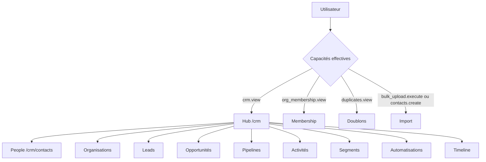

# Fusion du CRM historique et du CRM workspace

> **Statut :** proposition de plan — aucun code n'est modifié par ce document.
> **Périmètre :** les deux implémentations CRM présentes sur la branche `A`.
> **Objectif :** une seule surface CRM, une seule fiche personne, une seule
> navigation, des droits qui décident de ce qui est visible et non plus l'URL.

---

## 1. Contexte

Deux CRM coexistent aujourd'hui, avec des doublons volontaires ou hérités :

| | CRM historique | CRM workspace |
|---|---|---|
| Entrée | `/admin/crm` | `/crm` |
| Public | Super Admin | Tous les profils portant la responsabilité CRM |
| Nature | Annuaire, fiche personne, timeline, membership, doublons | Organisations, leads, opportunités, pipelines, activités, segments, automatisations |
| Modèle de données | `contacts`, `contact_roles`, `contact_timeline` | `contacts` (la personne) + tables `crm_*` (la couche commerciale) |

La couche données est **déjà unifiée** : le CRM workspace s'appuie sur la table
`contacts` pour les personnes, et le « lot 1 » a déjà posé une fiche personne
unique (`PersonRecordScreen`, historique append-only, prochaine action). La
fusion restante est donc principalement **une fusion d'écrans, de navigation,
de droits et de vocabulaire** — pas une migration de base.

---

## 2. Inventaire

### 2.1 CRM historique

| Route | Fichier | Contenu | API |
|---|---|---|---|
| `/admin/crm` | `src/app/admin/crm/page.js` | 4 KPI (contacts, approbations en attente, programmes actifs, ajouts du mois), 5 liens rapides, 8 contacts récents | `/api/contacts`, `/api/superadmin/full-state` |
| `/admin/crm/people/[cid]` | `src/app/admin/crm/people/[cid]/page.js` | Enveloppe de `PersonRecordScreen` avec `basePath="/admin/crm"` | `/api/contacts/*` |
| `/admin/crm/timeline` | `src/app/admin/crm/timeline/page.js` | Enveloppe de `TimelineScreen` | `/api/contacts/[cid]/timeline` |
| `/admin/crm/membership` | `src/app/admin/crm/membership/page.js` | `MembershipScreen` avec les actions d'écriture | `/api/org-membership` |
| `/admin/crm/duplicates` | `src/app/admin/crm/duplicates/page.js` | File des doublons, aperçu et fusion | `/api/contacts/duplicates`, `/api/contacts/merge` |
| `/admin/communications/contacts` | `src/app/admin/communications/contacts/page.js` | Annuaire complet : création, édition, suppression, invitations, groupes, assignation en masse, segments de communication | `/api/contacts/*` |
| `/admin/communications/segments` | `src/app/admin/communications/segments/page.js` | Listes de diffusion (concept différent des segments CRM) | `/api/segments` |
| `/admin/pending-users` | `src/app/admin/pending-users/page.js` | Approbation des comptes | `/api/admin/pending-users` |
| `/admin/bulk-upload` | `src/app/admin/bulk-upload/page.js` | Import CSV de contacts | `/api/admin/bulk-upload` |

Navigation : nœud maître `crm` (`src/lib/masterNavigation/nodes.js`) avec sept
enfants : Dashboard, People, Membership, Timeline, Duplicates, Pending approvals,
Bulk import. Le nœud entier est filtré par `contacts.view`
(`src/lib/masterNavigation/access.js`).

### 2.2 CRM workspace

| Route | Fichier | Objet |
|---|---|---|
| `/crm` | `src/app/crm/page.js` | Hub : recherche globale, tableau de bord d'action, cartes |
| `/crm/contacts` | `src/app/crm/contacts/page.js` | Annuaire **lecture seule** |
| `/crm/organizations` | `src/app/crm/organizations/page.js` | Organisations + liens personne ↔ organisation |
| `/crm/leads` + `/[id]` | `src/app/crm/leads/` | Leads, score, qualification, prochaine action |
| `/crm/opportunities` + `/[id]` | `src/app/crm/opportunities/` | Opportunités, étapes, historique |
| `/crm/pipelines` | `src/app/crm/pipelines/page.js` | Pipelines et étapes |
| `/crm/activities` | `src/app/crm/activities/page.js` | Flux global d'activités et tâches |
| `/crm/segments` | `src/app/crm/segments/page.js` | Segments d'enregistrements (filtre sauvegardé) |
| `/crm/automations` | `src/app/crm/automations/page.js` | Règles, conditions, actions, journal |
| `/crm/timeline` | `src/app/crm/timeline/page.js` | `TimelineScreen` avec `basePath="/crm"` |
| `/crm/membership` | `src/app/crm/membership/page.js` | `MembershipScreen` en lecture seule |
| `/crm/people/[cid]` | `src/app/crm/people/[cid]/page.js` | `PersonRecordScreen` avec `basePath="/crm"` |

Capacités : module `crm` (`view`, `create`, `edit`, `delete`, `assign`,
`manage`) pour les objets commerciaux ; module `contacts` pour la personne ;
`org_membership` pour le roster ; `duplicates` et `bulk_upload` existent dans le
catalogue mais ne sont pas encore utilisés par leurs API respectives.

### 2.3 Ce qui est déjà mutualisé

- `PersonRecordScreen` : une seule fiche personne, deux portes.
- `TimelineScreen` : un seul écran, `basePath` paramétrable.
- `MembershipScreen` : un seul écran, `readOnly` paramétrable.
- `contact_timeline` : une seule timeline, alimentée par les deux CRM.
- Les tables `crm_*` ne dupliquent pas les contacts : elles les référencent.

---

## 3. Conflits à résoudre

1. **Deux tableaux de bord.** `/admin/crm` (KPI + liens) et `/crm` (recherche +
   actions) répondent à la même question « où en est mon CRM ? ».
2. **Deux annuaires de personnes.** `/admin/communications/contacts` (écriture)
   et `/crm/contacts` (lecture seule). Le même humain a deux listes.
3. **Trois écrans à double porte.** Personne, timeline et membership existent
   sous `/admin/crm/*` et `/crm/*`, avec des différences portées par l'URL
   (`basePath`, `readOnly`) au lieu des capacités.
4. **Deux notions de « segment ».** Les listes de diffusion
   (`/admin/communications/segments`, clés `crm.segments.*`) et les segments
   d'enregistrements (`/crm/segments`, clés `crm.intelligence.segments.*`).
   La collision de namespace i18n est déjà documentée dans
   `docs/CRM_INTEGRATION_NOTES.md`.
   Une **liste de diffusion** est un public sauvegardé : on choisit des
   critères (statut, programme, rôle, campagne…), l'application recalcule à tout
   moment les personnes qui y correspondent, et on l'utilise pour envoyer un
   message ou lancer une campagne. Elle ne stocke pas une copie des personnes.
   Un **segment CRM** filtre des fiches de vente (leads, opportunités) pour les
   consulter, pas pour les contacter. Même mot, deux métiers différents.

   **Constat important :** l'ancien écran des listes de diffusion est déjà
   **retiré** — sa page répond « introuvable », son service refuse les demandes,
   et il n'est plus dans le menu. Le seul écran de segments vivant est celui du
   CRM. La décision « garder les listes de diffusion sous CRM » ne demande donc
   aucun déplacement : elle interdit simplement de recréer une deuxième entrée
   ailleurs. Si le besoin de listes de diffusion revient, il sera rouvert comme
   une fonction CRM, pas comme un écran de Communication.
5. **Deux portes de permission.** La section CRM est filtrée par
   `contacts.view`, alors que le hub workspace se gate sur `crm.view`.
   Un profil qui n'a que `crm.view` ne voit pas la section ; un profil qui n'a
   que `contacts.view` voit le hub mais aucune carte commerciale.
6. **Navigation incomplète.** Les nouveaux objets (organisations, leads,
   opportunités, pipelines, activités, segments, automatisations) ne sont pas
   dans `nodes.js` : ils ne sont atteignables que par les cartes du hub.
   `feature-subsections.js` cite `crm_organizations` et `crm_leads`, qui
   n'existent pas dans l'arbre de navigation.
7. **Liens de retour figés.** 32 occurrences de `/admin/crm` dans `src/`,
   dont les liens retour de Communication et de l'import plateforme.
8. **Écrans d'administration orphelins.** Doublons, import CSV et approbations
   restent sous `/admin` alors qu'ils concernent le CRM ou les comptes.
9. **Doublons de droits incohérents.** Le module `duplicates` (`view`,
   `resolve`) existe mais `/api/contacts/duplicates` vérifie en réalité
   `contacts.view` / `contacts.edit`.
10. **Tests et fixtures figés.** `navigation.test.js` encode les anciennes
    routes ; `roleGateExceptionsExtended.js` liste `/admin/crm/page.js`.

---

## 4. Architecture cible

### 4.1 Principe

**Une seule surface : `/crm`.** Le rôle décide de la coquille et du menu ; la
capacité décide des portes et des actions. L'URL ne décide plus de rien.

### 4.2 Table de correspondance des routes

| Ancienne route | Route cible | Décision |
|---|---|---|
| `/admin/crm` | `/crm` | Redirection 308 ; le hub devient l'unique tableau de bord |
| `/admin/crm/people/[cid]` | `/crm/people/[cid]` | Redirection ; une seule fiche |
| `/admin/crm/timeline` | `/crm/timeline` | Redirection ; un seul écran |
| `/admin/crm/membership` | `/crm/membership` | Redirection ; écriture pilotée par `org_membership.manage` |
| `/admin/crm/duplicates` | `/crm/duplicates` | Déplacement ; gate `duplicates.view` + `duplicates.resolve` (ou alignement sur `contacts.*`) |
| `/admin/communications/contacts` | `/crm/contacts` | Fusion ; les outils purement « communication » restent dans Communication |
| `/admin/bulk-upload` | inchangé | **Décision validée :** l'import CSV reste sous `/admin`, accessible depuis le CRM par un lien |
| `/admin/pending-users` | inchangé | **Décision validée :** les approbations restent dans la section CRM |
| `/admin/communications/segments` | retiré (déjà désactivé) | L'écran renvoie déjà « page introuvable » et son service refuse les demandes ; **décision validée :** le concept de liste de diffusion reste sous CRM, porté par l'écran unique `/crm/segments` |
| `/crm/*` (nouveaux objets) | inchangé | Devient la seule surface |

Les redirections restent **une release** après la bascule, puis sont supprimées.

### 4.3 Matrice de droits cible

| Écran / action | Module | Capacité |
|---|---|---|
| Hub CRM, leads, opportunités, pipelines, activités, segments, automatisations, organisations | `crm` | `view` |
| Créer un lead / contact / organisation / segment | `crm` et/ou `contacts` | `create` |
| Éditer, scorer, qualifier, déplacer une étape | `crm` | `edit` |
| Supprimer / retirer un lien | `crm` | `delete` |
| Assigner un propriétaire | `crm` | `assign` |
| Automatisations, création/édition de pipelines | `crm` | `manage` |
| Annuaire des personnes, fiche, timeline | `contacts` | `view` |
| Créer / éditer / supprimer une personne | `contacts` | `create` / `edit` / `delete` |
| Inviter une personne | `contacts` | `create` |
| Roster de membership (lecture) | `org_membership` | `view` |
| Roster (écriture) | `org_membership` | `manage` |
| File des doublons | `duplicates` | `view` |
| Fusionner des doublons | `duplicates` | `resolve` |
| Import CSV | `bulk_upload` | `execute` |

**Décision validée :** les API des doublons sont alignées sur le module
`duplicates`. Pendant la transition, elles acceptent aussi `contacts.edit` pour
ne pas retirer l'accès aux profils déjà autorisés ; la tolérance est retirée en
phase 5. L'import CSV reste protégé par `bulk_upload.execute`, avec le repli
actuel sur `contacts.create` conservé.

### 4.4 Navigation cible

Le nœud maître `crm` doit exposer les objets réels, dans cet ordre :

1. Hub (`/crm`)
2. People (`/crm/contacts`)
3. Organisations (`/crm/organizations`)
4. Leads (`/crm/leads`)
5. Opportunités (`/crm/opportunities`)
6. Pipelines (`/crm/pipelines`)
7. Activités (`/crm/activities`)
8. Segments (`/crm/segments`)
9. Automatisations (`/crm/automations`)
10. Timeline (`/crm/timeline`)
11. Membership (`/crm/membership`) — si `org_membership.view`
12. Doublons (`/crm/duplicates`) — si `duplicates.view`
13. Pending approvals (`/admin/pending-users`) — si la capacité d'administration
    des comptes ; **décision validée : reste dans la section CRM**
14. Import CSV (`/admin/bulk-upload`) — si `bulk_upload.execute` ; **décision
    validée : reste sous `/admin`**

Chaque nœud reçoit une entrée dans `NAV_CAPABILITY_REQUIREMENTS`. Le nœud
section `crm` passe de `contacts.view` à `crm.view`, avec `all_contacts` et
`crm_timeline` gatés séparément par `contacts.view`.

### 4.5 i18n

- Toutes les nouvelles chaînes passent par `t()` et existent en `en` **et** `fr`.
- `crm.intelligence.segments.*` reste le namespace des segments CRM.
- `crm.segments.*` appartient à l'écran de listes de diffusion **retiré**. Ces
  clés sont supprimées en phase 5 si le retrait est confirmé ; si la fonction
  est un jour réactivée sous CRM, elles seront réutilisées telles quelles et
  restent sous le même namespace `crm.*`.
- `crm.overview.*` et `crm.hub.*` sont fusionnés dans un seul namespace
  `crm.hub.*` (ou supprimés s'ils deviennent inutiles).
- `npm run i18n:parity` doit rester à **Missing 0**.

---

## 5. Plan par phases

Chaque phase est livrable et testable seule. Les estimations sont indicatives.

### Phase 0 — Socle et gel (0,5 j) — **faite le 2026-10-27**

**Tâches**
- Créer une branche `crm-merge` depuis `A`. ✅
- Relever l'état de référence : `npm run lint`, `npm test`, `npm run build`,
  `npm run i18n:parity`, captures des menus super admin / staff / crm. ✅
- Lister les occurrences de `/admin/crm` et `/admin/communications/contacts`. ✅
- Annoncer le gel des évolutions sur `/admin/crm` pendant la fusion. ✅

**Critères d'acceptation**
- Baseline consignée dans le §11 de ce document.
- Aucune modification fonctionnelle.

### Phase 1 — Droits et navigation (1–2 j) — **faite le 2026-10-27**

**Tâches**
- Ajouter les nœuds manquants dans `src/lib/masterNavigation/nodes.js`.
- Mettre à jour `ROLE_ACCESS.super_admin.children.crm` et `ROLE_ACCESS.crm`.
- Compléter `NAV_CAPABILITY_REQUIREMENTS` (section `crm` → `crm.view`,
  `all_contacts` et `crm_timeline` → `contacts.view`, nouveaux objets → `crm.view`).
- Aligner `src/models/authorization/feature-subsections.js` sur les nœuds réels
  (retirer `crm_organizations`/`crm_leads` fantômes ou les créer, ajouter les
  objets manquants).
- Corriger le hub `/crm` pour gater chaque carte sur **son** module
  (`crm`, `contacts`, `org_membership`, `duplicates`, `bulk_upload`) au lieu de
  tout conditionner à `crm.view`.
- Placement **validé** : Pending approvals reste dans la section CRM ;
  l'import CSV reste sous `/admin` et le hub y renvoie par un lien.

**Fichiers principaux**
- `src/lib/masterNavigation/nodes.js`
- `src/lib/masterNavigation/access.js`
- `src/lib/masterNavigation/builders.js` (si un nœud « any-of » est nécessaire)
- `src/models/authorization/feature-subsections.js`
- `src/app/crm/page.js`
- `src/__tests__/navigation.test.js`

**Critères d'acceptation**
- Le super admin voit toutes les entrées, une seule fois, sans lien mort.
- Un profil `crm.view` sans `contacts.view` voit la section et les objets
  commerciaux, mais pas People/Timeline.
- Un profil `contacts.view` sans `crm.view` voit People/Timeline.
- Les fixtures de navigation sont mises à jour avec approbation explicite.
- `npm run lint` et `npm test` verts.

### Phase 2 — Un seul tableau de bord (1 j) — **faite le 2026-10-27**

**Tâches**
- Fusionner les KPI du `/admin/crm` historique (contacts, approbations,
  programmes actifs, ajouts du mois, contacts récents) dans le hub `/crm`,
  avec les cartes admin-only visibles uniquement si la capacité est détenue.
- Conserver `CrmGlobalSearch` et `CrmActionDashboard`.
- Utiliser les briques partagées `PageHero`, `KpiCard`, `StatusCard`,
  `SectionHead`, `LinkCard` (règle AGENTS) au lieu des styles ad hoc.
- Remplacer `/admin/crm` par une redirection serveur vers `/crm`.

**Critères d'acceptation**
- Toutes les informations de l'ancien dashboard sont accessibles depuis `/crm`.
- Aucun doublon de KPI.
- `/admin/crm` répond par une redirection, sans boucle.

### Phase 3 — Un seul annuaire de personnes (2–3 j) — **faite le 2026-10-27**

**Tâches**
- Faire de `/crm/contacts` l'annuaire canonique.
- Y porter les affordances d'écriture aujourd'hui dans
  `/admin/communications/contacts`, chacune derrière sa capacité
  (`contacts.create`, `contacts.edit`, `contacts.delete`).
- Séparer ce qui relève de la **communication** (campagnes, invitations de
  groupe, réponses) et le laisser sous `/admin/communications/*`. Les listes de
  diffusion, elles, restent sous CRM (décision validée) ; leur ancien écran
  désactivé n'est pas rouvert par cette phase.
- Rediriger `/admin/communications/contacts` vers `/crm/contacts`.
- Remplacer les `basePath` par défaut `/admin/crm` par `/crm` dans
  `PersonRecordScreen`, `PersonHeader`, `TimelineScreen`.
- Mettre à jour les liens retour de `campaigns`, `responses` et
  `admin/platform/import/review`. L'écran de listes de diffusion étant retiré,
  il ne fait plus partie des liens à corriger.

**Critères d'acceptation**
- Une seule liste de personnes, une seule fiche, un seul dossier.
- Création/modification/suppression fonctionnent depuis `/crm/contacts`.
- Les flux de communication restent atteignables et inchangés.
- Aucune occurrence fonctionnelle de `/admin/communications/contacts`.

### Phase 4 — Modules d'administration sous `/crm` (1–2 j) — **faite le 2026-10-27**

**Tâches**
- Déplacer les doublons vers `/crm/duplicates` et aligner leur API sur le
  module `duplicates` (tolérance temporaire sur `contacts.edit`).
- L'import CSV reste sous `/admin` (décision validée) ; vérifier que le lien
  depuis People et depuis le hub est correct.
- Supprimer la prop `readOnly` de `MembershipScreen` : l'écriture est dérivée
  de `org_membership.manage` via `useCrmCapabilities`.
- Vérifier que `crm.manage` protège bien automatisations et pipelines.

**Critères d'acceptation**
- Le super admin réalise toutes les actions de l'ancien CRM depuis `/crm`.
- Un profil non admin ne voit ni les doublons, ni l'import, ni les actions
  d'écriture du roster.
- Les API conservent leurs gates (aucune régression de sécurité).

### Phase 5 — Retrait et nettoyage (1 j)

**Tâches**
- Supprimer les pages `/admin/crm/*` devenues des redirections.
- Supprimer les props `basePath`/`readOnly` devenues inutiles.
- Nettoyer l'i18n : suppression des clés de l'écran de listes de diffusion
  retiré, fusion `crm.hub.*`, suppression des clés mortes ; parité en/fr.
- Ne pas supprimer le code de l'écran retiré sans décision explicite : il est
  conservé pour une réactivation éventuelle (voir §9).
- Mettre à jour `docs/CRM_WORKSPACE_CASE_STUDY.md`,
  `docs/CRM_INTEGRATION_NOTES.md` et toute référence aux anciennes routes.
- Mettre à jour `roleGateExceptionsExtended.js` et les tests de navigation.

**Critères d'acceptation**
- `grep -rn "/admin/crm" src` ne renvoie que les redirections et les tests.
- `npm run lint`, `npm test`, `npm run build`, `npm run i18n:parity` verts.
- `docs/` ne décrit plus qu'une seule surface.

---

## 6. Tests et validation

### Tests à ajouter ou adapter

| Test | Objet |
|---|---|
| `src/__tests__/navigation.test.js` | Fixtures des nouveaux nœuds et des gates |
| `src/__tests__/crm-workspace-ui.test.js` | Cartes du hub, redirections, liens |
| `src/__tests__/crm-workspace-management-ui.test.js` | Actions admin vues depuis `/crm` |
| Nouveau `crm-route-redirects.test.js` | `/admin/crm/*` → `/crm/*` sans boucle |
| Nouveau `crm-people-consolidation.test.js` | CRUD personne depuis `/crm/contacts` |
| `src/__tests__/permissions-*` | Gates `crm` / `contacts` / `duplicates` |
| `npm run i18n:parity` | Aucune clé manquante en/fr |

### Validation manuelle (staging, jamais `.env.local`)

Le `.env.local` de ce poste pointe sur **la production** (voir AGENTS.md §7).
Utiliser `.env.audit-staging` pour toute vérification de données, et faire la
passe navigateur sur staging :

1. Super admin : `/crm` affiche tous les KPI, toutes les cartes, tous les objets.
2. Staff avec `crm.view` seul : objets commerciaux visibles, People absent.
3. Staff avec `contacts.view` seul : People/Timeline visibles, leads absents.
4. Créer un contact, éditer la fiche, ouvrir la timeline.
5. Créer une organisation, lier une personne, créer un lead, le scorer.
6. Créer une opportunité, déplacer une étape, vérifier l'historique.
7. Doublons : voir la file, fusionner.
8. Import CSV : exécuter avec `bulk_upload.execute`.
9. Membership : écrire avec `org_membership.manage`, lecture seule sinon.
10. Vérifier qu'aucune route `/admin/crm/*` ne renvoie 404.

La promotion vers `main` reste soumise à `docs/PRODUCTION_TEST.md`, qui est un
contrôle de **données** autant que de code.

---

## 7. Risques et parades

| Risque | Impact | Parade |
|---|---|---|
| La projection de navigation casse un menu existant | Élevé | Fixtures de `navigation.test.js` mises à jour **avant** le code ; revue explicite |
| Un profil perd l'accès au CRM après le passage à `crm.view` | Élevé | Période de tolérance : le hub et la section acceptent `crm.view` **ou** `contacts.view` jusqu'à la fin de la phase 5 |
| Redirection en boucle | Moyen | Test dédié ; redirections serveur uniquement, jamais côté client |
| Perte d'une affordance admin (doublons, import, membership) | Moyen | Checklist de parité écran par écran en phase 4 |
| Collision i18n `segments` | Faible | Le namespace des listes de diffusion est mort avec leur écran ; le supprimer en phase 5 (ou le conserver sous `crm.*` si la fonction est rouverte), et garder `crm.intelligence.segments.*` pour les segments CRM |
| Tests de rôle figés | Faible | Mise à jour de `roleGateExceptionsExtended.js` et des fixtures |
| Écriture accidentelle en production pendant la passe | Élevé | Utiliser staging ; `scripts/db-audit/run-readonly.mjs` pour les lectures |

---

## 8. Retour arrière

- Chaque phase est une PR séparée : revert de la PR en cas de régression.
- Les redirections sont conservées une release : revenir à l'ancienne route ne
  casse aucun lien.
- Aucune migration destructive n'est nécessaire : le retour arrière est purement
  du code.
- Les capacités existantes ne sont pas supprimées avant la phase 5.

---

## 9. Décisions

### Validées

1. **Pending approvals** : restent dans la section CRM.
2. **Bulk import** : reste sous `/admin`.
3. **Doublons** : l'API est alignée sur le module `duplicates` (avec tolérance
   temporaire sur `contacts.edit`).
4. **Listes de diffusion** : elles restent sous CRM. L'ancien écran étant déjà
   retiré, la décision se traduit par **une seule entrée « Segments » sous CRM**
   (`/crm/segments`) et aucune recréation dans Communication.

### À valider

5. **Réactivation éventuelle** : faut-il un jour rouvrir les listes de
   diffusion comme fonction CRM (mêmes données, nouvel écran), ou considérer
   le retrait comme définitif et supprimer le code conservé ?
6. **Durée des redirections** : une release ou suppression immédiate ?
7. **`/admin/crm`** : redirection 308 (permanent) ou page « déplacé » avec lien ?

---

## 10. Ordre d'exécution recommandé

1. Phase 0 (socle)
2. Phase 1 (droits + navigation) — **la phase qui débloque tout le reste**
3. Phase 2 (hub) et Phase 3 (personnes) en parallèle si deux développeurs
4. Phase 4 (admin) après la phase 3
5. Phase 5 (retrait) une fois la passe navigateur staging validée

Durée indicative totale : **6 à 9 jours** de développement, hors revue et hors
passe de recette staging.

---

## 11. Relevés de validation

### Relevé de la phase 0 (2026-10-27)

| Élément | Valeur |
|---|---|
| Branche | `crm-merge`, créée depuis `A` |
| Commit de départ | `f47b3edcc feat(crm): time-based automation triggers` |
| `npm run lint` | **0 erreur**, 259 avertissements |
| `npm run i18n:parity` | **Missing 0**, Identical 584, Obsolete 0 |
| `npm test` | **22 suites en échec / 90 tests**, 8 333 réussis, 9 ignorés |
| `npm run build` | **succès** |
| Références à `/admin/crm` | 32 occurrences dans 18 fichiers |
| Références à `/admin/communications/contacts` | 9 occurrences dans 8 fichiers |

Les 22 suites déjà en échec au départ (aucune n'est une suite CRM) :
`journey-report-deliverables`, `verification-upload`,
`permissions-characterization`, `reminder-email-content`,
`identity-gate-bridge`, `profile-role-rule-phase-b`, `ventures/ventures`,
`venture-document-types`, `journey-delete-super-admin`, `ventures/lead`,
`venture-company-status`, `ventures/templates`, `ventures/staff-actor`,
`deliverable-upload-access`, `venture-detail-view-wiring`, `use-api-hook`,
`server/auth-boundaries`, `action-declarations`, `reminders-routes`,
`ventures/api`, `server/line-limits`, `responsibility-assign-decisions`.

Elles constituent la dette de départ. **La phase 1 ne doit pas en ajouter.**
Trois d'entre elles touchent directement les droits et la navigation
(`permissions-characterization`, `server/auth-boundaries`,
`responsibility-assign-decisions`) : elles resteront rouges pendant la fusion et
ne peuvent donc pas servir de signal de non-régression. Les tests CRM et de
navigation, eux, sont verts et doivent le rester.

### Relevé de la phase 1 (2026-10-27)

**Ce qui a changé**

- La section CRM s'ouvre désormais par **l'un** de ces droits : `crm.view`
  (objets commerciaux), `contacts.view` (personnes et timeline) ou
  `org_membership.view` (roster seul). La projection de navigation sait
  maintenant exprimer « l'un ou l'autre ».
- Les nœuds des objets réels sont dans l'arbre de navigation : organisations,
  leads, opportunités, pipelines, activités, segments, automatisations.
- Chaque enfant garde son propre droit : People et Timeline → `contacts.view` ;
  objets commerciaux → `crm.view` ; Membership → `org_membership.view` ;
  doublons → `duplicates.view` ; approbations → `permissions.view_matrix` ;
  import → `bulk_upload.execute`.
- Le rôle de repli CRM projette la section entière (et non plus seulement le
  hub), avec des liens non-admin vers `/crm/*`.
- Le hub `/crm` gate désormais **chaque carte sur son propre module** : un
  profil « personnes seulement » voit People et Timeline, un profil
  « objets commerciaux seulement » voit les leads et opportunités, et aucun des
  deux ne voit une porte que son API refuserait.
- `feature-subsections.js` est aligné sur les nœuds réels ; les identifiants
  fantômes sont remplacés par les objets existants.
- Libellés de navigation et fils d'Ariane ajoutés en **en** et **fr**.

**Fichiers modifiés** : `src/lib/masterNavigation/nodes.js`,
`src/lib/masterNavigation/access.js`, `src/lib/masterNavigation/builders.js`,
`src/components/layout/shell/navigation.js`,
`src/components/layout/shell/useDashboardNavigation.js`, `src/app/crm/page.js`,
`src/models/authorization/feature-subsections.js`, les deux fichiers de
navigation `en`/`fr`, et les tests de navigation / équivalence UI-serveur.

**Validation**

| Vérification | Résultat |
|---|---|
| Tests ciblés (navigation + équivalence UI/serveur) | 38/38 |
| Suite complète | même baseline : 22 suites / 90 tests déjà rouges, aucune nouvelle suite |
| Build | succès |
| Parité i18n | Missing 0 |
| Lint des fichiers touchés | 0 erreur |

Le garde-fou de taille signale une violation **préexistante** sur un fichier
Ventures non touché (`ventureDataRoomStore.js`), sans rapport avec cette fusion.

### Relevé de la phase 2 (2026-10-27)

**Ce qui a changé**

- Le hub `/crm` porte désormais les quatre figures de l'ancien tableau de bord
  (contacts, approbations en attente, programmes actifs, ajouts du mois), les
  contacts récents et les trois portes d'administration.
- Les figures suivent `contacts.view` ; les portes d'administration (approbations,
  import, doublons) ne sont rendues que pour le Super Admin, car leurs écrans
  vivent encore sous `/admin` — les déplacer est le travail des phases 3 et 4.
- `/admin/crm` n'est plus un écran : c'est une **redirection serveur** vers
  `/crm`, conservée une release pour les signets et les liens retour.
- Le nœud de navigation « Dashboard » pointe maintenant sur `/crm`.
- Le composant `CrmOverview` réutilise les briques partagées (`KpiCard`,
  `SectionHead`, `LinkCard`) et le cache de lecture commun.

**Fichiers modifiés** : `src/components/crm/CrmOverview.js` (nouveau),
`src/app/crm/page.js`, `src/app/admin/crm/page.js`, `src/lib/masterNavigation/nodes.js`,
`src/__tests__/navigation.test.js`,
`src/__tests__/helpers/roleGateExceptionsExtended.js` (entrée périmée retirée),
et les deux fichiers `crm.json`.

**Validation**

| Vérification | Résultat |
|---|---|
| Tests ciblés (navigation, équivalence, ratchet, écrans CRM) | 59/59 |
| Suite complète | même baseline : 22 suites / 90 tests déjà rouges, aucune nouvelle suite |
| Build | succès |
| Parité i18n | Missing 0 |
| Lint des fichiers touchés | 0 erreur |

### Relevé de la phase 3 (2026-10-27)

**Ce qui a changé**

- `/crm/contacts` est le seul annuaire. Il choisit par droit, pas par URL :
  - le Super Admin voit l'écran complet (création, édition, invitation,
    groupes, assignation en masse), exactement ce que l'ancienne route rendait ;
  - les autres profils gardent la liste en lecture seule, car les affordances
    d'écriture de cet écran ne sont pas encore gatées individuellement.
- `/admin/communications/contacts` est une **redirection serveur** vers
  `/crm/contacts`.
- La navigation « People » pointe sur `/crm/contacts`.
- Les liens retour de l'écran, du tableau de bord admin, du centre de
  notifications et la largeur pleine du shell suivent la nouvelle route.
- L'écran partagé vit dans `src/components/contacts/ContactsScreen.js` ; ses
  sous-composants restent encore dans l'ancien dossier, importés explicitement.
  **Les déplacer est le nettoyage de la phase 5**, pas un changement de
  comportement.

**Limite assumée :** le plein écran n'est rendu que pour le Super Admin. Un
profil non-admin disposant de droits d'écriture verrait encore la lecture seule.
Ce n'est pas une régression (l'ancienne route était admin-only), mais c'est un
suivi à faire si l'on veut ouvrir l'écriture aux profils CRM.

**Fichiers modifiés** : `src/components/contacts/ContactsScreen.js` (nouveau),
`src/app/crm/contacts/page.js`,
`src/app/admin/communications/contacts/page.js`,
`src/app/admin/communications/contacts/ContactsHeader.js`,
`src/app/admin/communications/contacts/useContactsState.js`,
`src/components/layout/DashboardLayout.js`,
`src/components/layout/shell/ShellHeader.js`, `src/app/admin/page.js`,
`src/lib/masterNavigation/nodes.js` et `src/__tests__/navigation.test.js`.

**Validation**

| Vérification | Résultat |
|---|---|
| Tests ciblés (navigation, équivalence, ratchet, gardes statiques, écrans CRM) | 62/62 |
| Suite complète | même baseline : 22 suites / 90 tests déjà rouges, aucune nouvelle suite |
| Build | succès |
| Parité i18n | Missing 0 |
| Lint des fichiers touchés | 0 erreur |

### Relevé de la phase 4 (2026-10-27)

**Ce qui a changé**

- **Doublons** : l'écran vit à `/crm/duplicates`. La lecture suit
  `duplicates.view` ; les boutons d'action suivent `duplicates.resolve` et
  disparaissent sinon. L'ancienne route redirige.
- **API des doublons alignée sur le module `duplicates`** : lecture/preview
  acceptent `duplicates.view` **ou** `contacts.view` ; dismissal et fusion
  acceptent `duplicates.resolve` **ou** `contacts.edit` / `contacts.delete`.
  La tolérance est temporaire et sera retirée en phase 5.
- **Membership** : une seule route `/crm/membership`. L'écran dérive lui-même
  son mode lecture/écriture de `org_membership.manage` (Super Admin bypasse)
  et n'affiche plus le lien « accès effectif » aux non-admins. L'ancienne route
  redirige.
- Le hub propose la carte Doublons à tout profil qui porte `duplicates.view` ;
  les approbations et l'import restent des portes du Super Admin.
- La navigation Membership et Doublons pointe maintenant sur `/crm/*`.

**Fichiers principaux** : `src/components/crm/DuplicatesScreen.js` (nouveau),
`src/app/crm/duplicates/page.js` (nouveau), `src/app/admin/crm/duplicates/page.js`,
`src/components/crm/MembershipScreen.js`, `src/app/crm/membership/page.js`,
`src/app/admin/crm/membership/page.js`, `src/server/authz/responses.js`,
`src/models/authorization/index.js`, les trois routes de doublons/fusion,
`src/components/crm/CrmOverview.js`, `src/app/crm/page.js`,
`src/lib/masterNavigation/nodes.js`, `src/lib/masterNavigation/access.js`,
`src/__tests__/navigation.test.js` et le lien de revue d'import.

**Validation**

| Vérification | Résultat |
|---|---|
| Tests ciblés (navigation, équivalence, ratchet, gardes statiques, écrans CRM) | 62/62 |
| Suite complète | même baseline : 22 suites / 90 tests déjà rouges, aucune nouvelle suite |
| Build | succès |
| Parité i18n | Missing 0 |
| Lint des fichiers touchés | 0 erreur |
