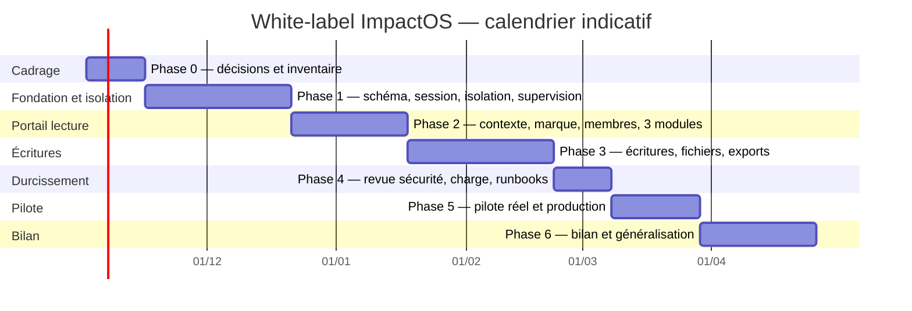

# White-label ImpactOS — Plan de réalisation et jalons

> **Statut : plan de réalisation proposé. Aucune ligne de code applicatif n’est
> modifiée par ce document.** Il traduit le modèle et la spécification en lots
> de travail, jalons, dépendances, critères de passage et gouvernance.
>
> **Documents de référence :**
> [`WHITE_LABEL_ORGANIZATION_MODEL.md`](./WHITE_LABEL_ORGANIZATION_MODEL.md) —
> le modèle conceptuel ;
> [`WHITE_LABEL_IMPLEMENTATION_SPEC.md`](./WHITE_LABEL_IMPLEMENTATION_SPEC.md) —
> la spécification technique ;
> [`ARCHITECTURE.md`](./ARCHITECTURE.md),
> [`AUTHZ_CURRENT_STATE.md`](./AUTHZ_CURRENT_STATE.md),
> [`PRODUCTION_TEST.md`](./PRODUCTION_TEST.md).

---

## 1. Objet du plan

Ce plan décrit **comment** livrer le white-label sans casser l’existant :

- les lots de travail et leur contenu ;
- l’ordre des dépendances ;
- les jalons et leurs critères de passage ;
- les rôles et responsabilités ;
- les gates de qualité, de sécurité et de production ;
- le calendrier indicatif et les hypothèses ;
- les risques et les plans de repli.

Il ne remplace pas les deux documents de conception : il les transforme en
exécution.

---

## 2. Périmètre

### 2.1 Dans le périmètre

- Une entité **Organisation cliente**, distincte des entreprises du CRM.
- Une appartenance personne ↔ organisation, avec rôles et périodes.
- Des rôles d’organisation dérivés de modèles globaux, avec un plafond.
- Les modules **Programmes**, **LMS** et **Venture** dans un portail client.
- Des données clientes séparées par organisation.
- Des fichiers privés, des exports filtrés, des e-mails et liens publics liés à
  une organisation.
- Une supervision Future Studio explicite, limitée et journalisée.
- Un pilote avec des organisations fictives, puis un client réel.

### 2.2 Hors périmètre de la première livraison

- CRM multi-organisations.
- Facturation et comptabilité client.
- SSO/SAML et fédération d’identité.
- Domaines personnalisés complets (le champ peut exister, l’activation est
  ultérieure).
- Application mobile dédiée.
- Place de marché de cours entre clients.
- Infrastructure physique dédiée par client.
- Migration de toutes les tables historiques : le pilote est borné.

Tout ajout au périmètre après le jalon **M0** passe par le contrôle de
changement (§ 12.3).

---

## 3. Hypothèses de travail

### 3.1 Équipe

Le calendrier suppose une équipe dédiée :

| Rôle | Charge indicative |
|---|---|
| Product owner / sponsor | 50 % |
| Tech lead / architecte | 80 % |
| 2 ingénieurs backend | 100 % chacun |
| 1 ingénieur frontend | 100 % |
| 1 QA / sécurité | 80 % |
| 1 ops / support | 40 % |
| Référent client pilote | 20 % |

Si l’équipe est plus petite, le calendrier s’allonge ; il ne se compresse pas
linéairement, car les gates de sécurité et de migration ne se parallélisent pas
tous.

### 3.2 Environnements

- **Staging** pour les migrations, les tests et le pilote fictif.
- **Production** uniquement pour la promotion finale.
- Sur ce poste, `.env.local` pointe sur la production : ne jamais l’utiliser pour
  appliquer la migration. Utiliser l’environnement de staging et les scripts
  read-only documentés dans `AGENTS.md`.
- Sauvegarde et point de restauration avant toute migration.

### 3.3 Produit

- Les décisions de § 11 sont tranchées au plus tard à **M0**.
- Les organisations fictives du pilote sont créées avant **M2**.
- Le client pilote est identifié avant **M4**.
- Les textes sont bilingues FR/EN dès le premier écran du portail.

### 3.4 Technique

- Une seule base, un seul code, une seule application.
- Le moteur de permissions existant n’est pas modifié en Phase 1.
- Le portail client est une entrée séparée.
- L’organisation active vient de la session authentifiée.
- Les migrations sont additives et réversibles.

---

## 4. Principes d’exécution

1. **Additif d’abord.** On ajoute des tables, des colonnes nullables et des
   routes ; on ne supprime rien.
2. **Deux portes.** La console interne et le portail client restent séparés.
3. **Le serveur décide.** Aucune organisation active fournie par le navigateur
   n’est acceptée comme autorité.
4. **Un lot, un gate.** Aucun lot ne commence avant que le gate précédent soit
   vert.
5. **Le pilote est borné.** Trois modules, un nombre limité d’écrans, des
   organisations fictives avant tout client réel.
6. **La sécurité n’est pas une phase finale.** Les tests d’isolation sont écrits
   avec chaque route, pas après.
7. **Pas de switch d’application de la règle.** Le garde du portail est toujours
   actif ; un interrupteur ne doit pas pouvoir être oublié.
8. **Le rollback est préparé avant le déploiement.**

### 4.1 Les quatre exigences structurantes issues de la revue

La revue a identifié quatre angles morts. Ils ne sont plus des "durcissements
plus tard" : ils deviennent des conditions de passage.

| Exigence | Décision | Où elle est traitée | Gate |
|---|---|---|---|
| **Protection des écrans internes** | Une requête interne est limitée à l’organisation plateforme par défaut ; elle ne voit une organisation cliente qu’avec un mandat de supervision. Les modèles du pilote exigent l’organisation. | Phase 1 (filtres et garde), Phase 2 (tests bidirectionnels) | G1 et G2 |
| **Compatibilité des écritures existantes** | Un déclencheur remplit l’organisation de session, sinon l’organisation plateforme. Chaque ancien chemin de création est testé avant le passage à `NOT NULL`. | Phase 1 | G1 |
| **Moment de la supervision** | La supervision est livrée en Phase 1 et testée avant l’activation de la première organisation cliente. Aucun accès au contenu client ne dépend d’un contrôle absent. | Phase 1 (schéma et garde), Phase 2 (application) | G1 et G2 |
| **Contraintes et historique** | Les suppressions, modifications interdites et portées inter-organisations sont refusées par des déclencheurs et des privilèges de base, pas seulement par le service. | Phase 1 | G1 et G4 |

**Conséquence sur le calendrier :** la Phase 1 passe de 3 à 5 semaines et la
Phase 4 de 3 à 2 semaines. Le total passe d’environ 20 à 25 semaines, hors marge.
Cette augmentation est le prix de l’isolation interne, de la compatibilité des
écritures et des garanties d’historique.

**Décision de méthode :** le verrou principal est le **filtre d’organisation
dans les modèles**, pas une politique de base. Le verrou de base (RLS) reste une
seconde ceinture optionnelle, car l’exécution actuelle interroge la base par
requêtes indépendantes sur un pool. Si le filtre applicatif n’est pas complet,
aucune donnée cliente ne passe en production.

---

## 5. Structure de découpage (WBS)

| Code | Chantier | Contenu principal | Responsable |
|---|---|---|---|
| **A** | Produit et décisions | Nommage, rôles, délégation, contenu partagé, suspension, conservation | PO |
| **B** | Données et migration | Inventaire, schéma, colonnes, backfill, index, contraintes, seed | TL + BE |
| **C** | Identité et session | Organisation active, changement d’organisation, atterrissage, cache | BE |
| **D** | Autorisation | Garde d’organisation, décision, rôles, périmètres, modules, supervision | TL + BE |
| **E** | API du portail | Contexte, membres, invitations, programmes, LMS, ventures, audit | BE |
| **F** | Interface du portail | Shell, marque, navigation, écrans, i18n, accessibilité | FE |
| **G** | Fichiers et communications | Stockage privé, téléchargements, exports, e-mails, liens publics | BE + OPS |
| **H** | Sécurité et qualité | Menaces, tests d’isolation, régression, charge, revue | QA |
| **I** | Déploiement et exploitation | Staging, sauvegardes, monitoring, runbooks, support, pilote | OPS |
| **J** | Documentation | Modèle, spécification, plan, runbook, guides | PO + TL |

---

## 6. Phases, lots et jalons

Le programme est découpé en six phases et un jalon de revue post-pilote.

```
M0         M1              M2              M3              M4              M5          M6
│          │               │               │               │               │           │
Cadrage → Fondation et isolation → Portail lecture → Écritures → Durcissement → Pilote → Bilan
 2 sem.          5 sem.                4 sem.          5 sem.         2 sem.       3 sem.    4 sem.
```

### Phase 0 — Cadrage et inventaire

**Objectif :** figer le périmètre, les décisions et la liste exacte des tables,
routes, fichiers, exports et jobs à traiter.

| Lot | Tâches | Livrables |
|---|---|---|
| A0 | Trancher les décisions de § 11 | Décisions signées |
| B0 | Inventorier les tables clientes candidates | Registre `tenantTables` initial |
| B0 | Inventorier les routes, jobs, exports, e-mails, liens publics | Cartographie des points d’entrée |
| B0 | Inventorier les lectures et écritures internes sur les tables du pilote | Cartographie des requêtes internes |
| B0 | Inventorier tous les chemins de création existants | Liste des chemins à tester |
| C0 | Vérifier le parcours de connexion et les sessions | Note d’impact |
| D0 | Vérifier les gardes et périmètres existants | Note de réutilisation |
| D0 | Décider le mode d’isolation interne : filtres de modèles, verrou de base ou hybride | Décision signée |
| D0 | Définir le mandat de supervision et le break-glass | Politique de supervision |
| H0 | Écrire le modèle de menace et la matrice d’isolation bidirectionnelle | Plan de tests |
| I0 | Vérifier staging, sauvegardes, monitoring | Plan d’environnement |
| J0 | Valider les trois documents | Revue de cadrage |

**Milestone M0 — Cadrage validé**

- Décisions produit tranchées ou arbitrées par le sponsor.
- Inventaire des tables et points d’entrée complet.
- Cartographie des lectures et écritures internes complète.
- Liste des anciens chemins de création à tester.
- Mode d’isolation interne et politique de supervision tranchés.
- Matrice d’isolation bidirectionnelle et modèle de menace validés.
- Plan de migration et de rollback validés.
- **Décision go / no-go pour la Phase 1.**

---

### Phase 1 — Fondation invisible

**Objectif :** créer les tables, l’organisation plateforme, les colonnes
nullables, le backfill, la session, l’isolation interne, la compatibilité des
écritures et la supervision. **Aucune donnée cliente n’est encore accessible.**

| Lot | Tâches | Livrables |
|---|---|---|
| B1 | Créer les tables `organizations`, marque, contrat, modules, appartenances, rôles, autorisations, invitations, licences, supervision, journal, conservation | Migration additive |
| B1 | Créer l’organisation plateforme et le seed des modèles de rôles | Seed idempotent |
| B1 | Ajouter `organization_id` nullable aux tables du pilote | Migration |
| B1 | Backfill vers l’organisation plateforme | Script idempotent + comptages |
| B1 | Créer les index et les unicités par organisation | Migration |
| B1 | Installer les déclencheurs d’écriture compatible | Migration |
| B1 | Tester chaque ancien chemin de création | Rapport de compatibilité |
| B1 | Installer les déclencheurs d’historique, d’immuabilité, de portée et de journal | Migration |
| C1 | Ajouter `active_organization_id` à la session | Migration + modèle |
| C1 | Exposer `activeOrganizationId` dans le contexte de session | Code |
| C1 | Résoudre et changer l’organisation active | Service + route |
| C1 | Invalider le cache de session et le cache d’organisation | Code |
| D1 | Ajouter le module de capacités `organization_admin` | Catalogue |
| D1 | Créer les modèles de rôles et les rôles de l’organisation plateforme | Seed |
| D1 | Ajouter le filtre d’organisation aux modèles du pilote, plateforme par défaut | Code + tests |
| D1 | Implémenter le schéma, le garde et les tests de supervision | Code + tests |
| H1 | Tests de schéma, d’unicité, de backfill et de compatibilité des écritures | Suites |
| H1 | Tests d’isolation interne et de garanties d’historique | Suites |
| H1 | Vérifier que les suites existantes restent vertes | Rapport |

**Milestone M1 — Fondation et isolation en place**

- Les tables et contraintes existent.
- L’organisation plateforme existe et toutes les données du pilote y sont
  rattachées.
- La session porte l’organisation active.
- Le changement d’organisation invalide les caches.
- Les requêtes internes sont limitées à l’organisation plateforme par défaut.
- Les anciens chemins de création renseignent l’organisation plateforme.
- La supervision est implémentée et testée.
- Les suppressions et modifications interdites échouent en base.
- Les écrans internes voient toujours les données de la plateforme comme avant
  et aucune ligne cliente sans mandat.
- **Décision go / no-go pour la Phase 2.**

**Critère dur :** aucune régression dans les suites de permissions existantes,
et isolation interne prouvée avant la première donnée cliente.

---

### Phase 2 — Portail en lecture

**Objectif :** ouvrir un portail client en lecture, avec marque, membres,
programmes, LMS et ventures. Aucune écriture client.

| Lot | Tâches | Livrables |
|---|---|---|
| D2 | Garde `requireOrganization` et décision d’accès | Garde + tests |
| D2 | Vérification du module, de l’appartenance et du rôle | Service + tests |
| D2 | Appliquer la supervision avant toute lecture d’une organisation cliente | Garde + tests |
| E2 | `GET /api/org/context` et `GET /api/org/profile` | API |
| E2 | `GET /api/org/members` | API paginée |
| E2 | `GET /api/org/programs`, `GET /api/org/lms/*`, `GET /api/org/ventures` | API |
| E2 | `GET /api/org/audit` | API |
| F2 | Layout `/o/[organizationCode]` et shell client | Pages + composants |
| F2 | Marque : logo, couleurs, nom, domaine affiché | Shell |
| F2 | Sélecteur d’organisation | Composant + route |
| F2 | Tableau de bord, programmes, LMS, ventures, membres | Écrans lecture |
| F2 | i18n `organization.*` EN/FR | Locales |
| G2 | Vérifier qu’aucun fichier client n’est exposé en lecture | Test |
| H2 | Matrice d’isolation en lecture, dans les deux sens | Suites |
| H2 | Tests de route : `401`, `403`, `404` | Suites |
| H2 | Vérifier qu’aucune organisation cliente n’est activée avant la supervision | Test de gate |

**Milestone M2 — Portail lecture**

- Une organisation fictive peut se connecter, voir sa marque et ses données.
- Les trois modules sont visibles en lecture.
- Les membres et le journal sont lisibles selon les droits.
- Aucun accès croisé en lecture, ni interne → client ni client → interne.
- La supervision est appliquée avant la lecture d’une organisation cliente.
- Aucune organisation cliente n’est activée avant que la supervision soit en place.
- **Décision go / no-go pour la Phase 3.**

---

### Phase 3 — Écritures, fichiers, exports

**Objectif :** rendre le portail utilisable pour le pilote : invitations,
rôles, inscriptions, remises, livrables, documents, partages et exports.

| Lot | Tâches | Livrables |
|---|---|---|
| A3 | Valider la matrice de délégation des rôles | Décision |
| D3 | Valider qu’un rôle d’organisation ne dépasse pas son modèle | Service + tests |
| E3 | `POST /api/org/invitations` et acceptation publique | API + page |
| E3 | `PATCH /api/org/members/[id]` | API |
| E3 | `PATCH /api/org/roles/[id]` | API |
| E3 | Écritures Programmes : inscriptions, affectations, sessions | API |
| E3 | Écritures LMS : inscriptions, progression, remises | API |
| E3 | Écritures Venture : membres, tâches, livrables, documents | API |
| G3 | Bucket privé `organization-files` | Stockage |
| G3 | `POST /api/org/files` et `GET /api/org/files/[id]` | API |
| G3 | Exports filtrés par organisation | Service + job |
| G3 | E-mails et notifications avec expéditeur d’organisation | Service |
| G3 | Liens publics et formulaires liés à une organisation | Routes |
| H3 | Matrice d’isolation en écriture, fichiers et exports | Suites |
| H3 | Tests de lien public réutilisé | Suites |

**Milestone M3 — Portail utilisable**

- Une organisation fictive peut inviter, affecter, inscrire, remettre,
  téléverser, télécharger et exporter.
- Le contenu partagé fonctionne sans partager les résultats.
- Aucun accès croisé en écriture, fichier ou export.
- **Décision go / no-go pour la Phase 4.**

---

### Phase 4 — Durcissement et pilote fictif

**Objectif :** prouver la tenue en charge, la conservation, la revue de sécurité
et le scénario complet avant tout client réel. La supervision est déjà en place
depuis la Phase 1.

| Lot | Tâches | Livrables |
|---|---|---|
| H4 | Revue de la supervision et du break-glass | Rapport |
| H4 | Vérifier qu’aucun accès n’a eu lieu sans mandat | Rapport |
| I4 | Scénario Horizon complet avec deux organisations fictives | Rapport de pilote |
| H4 | Revue de sécurité et modèle de menace bidirectionnel | Rapport |
| H4 | Test de charge et budgets de requêtes | Rapport |
| H4 | Vérification des jobs de fond | Rapport |
| G4 | Suspension, archivage, export et conservation | Runbook |
| I4 | Runbooks support et incident | Documents |
| H4 | Vérifier le verrou de base (si retenu) | Rapport |
| J4 | Mettre à jour les documents | Docs |

**Milestone M4 — Durcissement validé**

- La revue confirme qu’aucun accès n’a eu lieu sans mandat.
- Le scénario Horizon passe de bout en bout.
- Les tests de charge respectent les budgets.
- Les runbooks de suspension et de conservation existent.
- Aucun incident d’isolation, dans les deux sens.
- **Décision go / no-go pour le pilote réel.**

---

### Phase 5 — Pilote réel et promotion

**Objectif :** accueillir un client réel sur staging, puis promouvoir en
production selon le test de production.

| Lot | Tâches | Livrables |
|---|---|---|
| I5 | Onboarding du client pilote | Organisation, marque, membres, modules |
| I5 | Formation des administrateurs clients | Guide + session |
| I5 | Support de proximité | Canal + runbook |
| H5 | Matrice d’isolation sur les données réelles | Rapport |
| I5 | Test de production (`docs/PRODUCTION_TEST.md`) | Checklist signée |
| I5 | Promotion et surveillance | Déploiement |
| I5 | Plan de rollback prêt | Runbook |

**Milestone M5 — Pilote en production**

- Le client réel utilise les trois modules.
- Le test de production est vert, item par item.
- Aucun accès croisé.
- Le support et le rollback sont prêts.
- **Décision go / no-go pour la généralisation.**

---

### Phase 6 — Bilan et généralisation

**Objectif :** mesurer, corriger, puis décider de l’industrialisation.

| Lot | Tâches | Livrables |
|---|---|---|
| A6 | Bilan produit et retours client | Rapport |
| H6 | Bilan incidents et performance | Rapport |
| I6 | Coût d’onboarding d’une nouvelle organisation | Mesure |
| J6 | Mise à jour du modèle et de la spécification | Docs |
| A6 | Décision : généraliser, corriger ou arrêter | Décision |

**Milestone M6 — Bilan de pilote**

- Les métriques sont connues.
- Les incidents sont clos ou planifiés.
- La décision de généralisation est prise.
- Le catalogue de configurations est documenté.

---

## 7. Calendrier indicatif

Hypothèse : démarrage le **2 novembre 2026**, hors congés de fin d’année. Le
calendrier est indicatif et sera recalibré à M0.



| Phase | Durée indicative | Fin indicative | Jalon |
|---|---|---|---|
| 0 — Cadrage | 2 semaines | 13/11/2026 | M0 |
| 1 — Fondation et isolation | 5 semaines | 18/12/2026 | M1 |
| 2 — Portail lecture | 4 semaines | 15/01/2027 | M2 |
| 3 — Écritures | 5 semaines | 19/02/2027 | M3 |
| 4 — Durcissement | 2 semaines | 05/03/2027 | M4 |
| 5 — Pilote | 3 semaines | 26/03/2027 | M5 |
| 6 — Bilan | 4 semaines | 23/04/2027 | M6 |

**Marge recommandée :** 15 à 20 %, soit environ 4 semaines, à placer avant M5.
Les congés de fin d’année et les dépendances client peuvent allonger la Phase 2
et la Phase 5. Le total passe d’environ 20 à 25 semaines : l’isolation interne,
la compatibilité des écritures et les garanties d’historique ne sont pas des
options de fin de programme.

### Charge indicative

| Chantier | Charge (personnes-semaines) |
|---|---|
| A — Produit et décisions | 3–4 |
| B — Données, migration et écritures compatibles | 10–14 |
| C — Identité et session | 3–4 |
| D — Autorisation, isolation interne et supervision | 9–12 |
| E — API | 8–11 |
| F — Interface | 9–12 |
| G — Fichiers et communications | 6–8 |
| H — Sécurité, tests d’isolation et garanties d’historique | 10–13 |
| I — Déploiement et support | 3–5 |
| **Total** | **61–83** |

Ces chiffres sont des ordres de grandeur, pas un engagement. Ils supposent une
équipe habituée au code et un périmètre stable après M0. L’augmentation par
rapport à la première estimation vient des quatre exigences de revue : isolation
interne, compatibilité des écritures, supervision avancée et garanties de base.

---

## 8. Dépendances et chemin critique

### 8.1 Chemin critique

```
Décisions M0
  → schéma + organisation plateforme
    → écritures compatibles + garanties d'historique
      → filtres internes (plateforme par défaut)
        → session + contexte d'organisation
          → garde d'autorisation + supervision
            → portail en lecture
              → écritures + fichiers + exports
                → revue de sécurité + charge
                  → test de production
                    → pilote réel
```

### 8.2 Dépendances structurantes

| Dépendance | Bloque | Raison |
|---|---|---|
| Décisions de rôle et de délégation | Phase 2 et 3 | Les écrans et les gardes en dépendent |
| Schéma et backfill | Phase 2 | Le contexte d’organisation lit ces tables |
| Filtres internes et compatibilité des écritures | Phase 2 | Aucune donnée cliente ne doit être accessible avant |
| Session avec organisation active | Phase 2 | Toutes les routes du portail en dépendent |
| Garde d’autorisation et supervision | Phase 2 | Aucune route cliente ne doit être ouverte avant |
| Rôle `organization_admin` | Phase 3 | Invitations et gestion des membres |
| Bucket privé | Phase 3 | Les fichiers clients ne peuvent pas être publics |
| Matrice d’isolation bidirectionnelle | M2 et M3 | Condition de passage |
| Garanties d’historique | M1 | Condition de conformité |
| Test de production | M5 | Condition de promotion |

### 8.3 Dépendances externes

- Validation des décisions produit par le sponsor.
- Disponibilité du client pilote pour le scénario Horizon.
- Accès à un environnement de staging représentatif.
- Validation juridique de la conservation et de l’export.
- Validation de la politique de supervision par la direction.

---

## 9. RACI

**R** = réalise, **A** = approuve, **C** = consulté, **I** = informé.

| Chantier | PO | TL | BE | FE | QA | OPS | Client |
|---|---|---|---|---|---|---|---|
| A — Produit et décisions | A/R | C | I | I | C | I | C |
| B — Données et migration | C | A | R | I | C | C | I |
| C — Identité et session | I | A | R | C | C | I | I |
| D — Autorisation | C | A | R | C | C | I | I |
| E — API | C | A | R | C | C | I | I |
| F — Interface | A | C | C | R | C | I | C |
| G — Fichiers et communications | C | A | R | C | C | C | I |
| H — Sécurité et qualité | I | C | C | C | A/R | C | I |
| I — Déploiement et support | I | C | C | C | C | A/R | C |
| J — Documentation | A | R | C | C | C | C | I |

---

## 10. Qualité, sécurité et gates

### 10.1 Gates

| Gate | Moment | Critère de passage |
|---|---|---|
| **G0** | Fin Phase 0 | Modèle, spécification et plan approuvés ; décisions tranchées |
| **G1** | Fin Phase 1 | Schéma, backfill, filtres internes, écritures compatibles, supervision et garanties d’historique vérifiés ; aucune régression |
| **G2** | Fin Phase 2 | Isolation bidirectionnelle verte ; supervision appliquée ; portail lecture démontré |
| **G3** | Fin Phase 3 | Isolation en écriture, fichiers et exports verte |
| **G4** | Fin Phase 4 | Revue de sécurité, charge, supervision et runbooks validés |
| **G5** | Fin Phase 5 | Test de production vert ; pilote réel accepté |
| **G6** | Fin Phase 6 | Bilan et décision de généralisation |

### 10.2 Tests obligatoires

| Niveau | Contenu |
|---|---|
| Unitaire | Modèles, rôles, autorisations, périmètres, licences |
| Service | Contexte d’organisation, changement d’organisation, délégation |
| Route | `401`, `403`, `404`, validation, CSRF, pagination |
| Isolation | Matrice par table du pilote, lectures et écritures, dans les deux sens |
| Écritures existantes | Chaque ancien chemin de création renseigne l’organisation plateforme |
| Supervision | Aucun accès à une organisation cliente sans mandat actif |
| Base de données | Suppressions, modifications interdites et portées inter-organisations refusées |
| Fichiers | Bucket privé, lien signé, téléchargement croisé |
| Exports | Aucune ligne d’une autre organisation |
| Jobs | `organization_id` obligatoire |
| Non-régression | Suites de permissions, build, lint, i18n |
| Charge | Budgets de requêtes et temps de réponse |
| Manuel | Scénario Horizon complet |

### 10.3 Commandes de vérification

```bash
npm test
npm run test:authz
npm run lint
npm run build
npm run check:lines
npm run i18n:parity
```

La promotion vers la production suit `docs/PRODUCTION_TEST.md`, item par item.

---

## 11. Décisions à trancher avant M0

| # | Décision | Recommandation | Impact si non tranchée |
|---|---|---|---|
| 1 | Nommage UI : Organisation / Entreprise CRM | Organisation pour la frontière, Entreprise pour le CRM | Confusion dans les écrans et le support |
| 2 | Contenu partagé : licence ou copie | Licence, copie seulement si édition | Bloque le partage de cours |
| 3 | Organisation suspendue : lecture seule ou blocage | Lecture seule avec période de grâce | Bloque la politique d’incident |
| 4 | Rôles personnalisés | Renommage et délégation en V1 | Bloque la gestion des membres |
| 5 | Investisseur : invité + partage ou partage direct | Invité + partage explicite | Bloque le portail investisseur |
| 6 | Conservation à la fin du contrat | Anonymiser par défaut, exporter avant | Bloque la clôture de contrat |
| 7 | Domaine personnalisé | Hors pilote, champ préparé | Aucun blocage si hors pilote |
| 8 | Éligibilité du portail | Plafond du modèle de rôle, distinct de l’interne | Bloque l’autorisation |
| 9 | Supervision du propriétaire de plateforme | Mandat obligatoire, break-glass journalisé | Bloque l’accès support |
| 10 | Isolation interne | Filtres de modèles en Phase 1 ; verrou de base optionnel en Phase 4/5 | Bloque toute donnée cliente |
| 11 | Compatibilité des écritures | Déclencheur d’écriture compatible, plateforme par défaut | Bloque le passage à `NOT NULL` |
| 12 | Moment de la supervision | Phase 1, activation cliente bloquée sans elle | Bloque le pilote |
| 13 | Garanties d’historique | Déclencheurs et privilèges de base | Bloque la conformité |

---

## 12. Gouvernance

### 12.1 Cadence

- **Quotidien :** point d’équipe de 15 minutes, blocages et dépendances.
- **Hebdomadaire :** revue d’avancement, risques, décisions, démonstration.
- **À chaque jalon :** revue formelle, go / no-go, mise à jour du plan.
- **Mensuel :** revue sponsor, budget, périmètre, qualité.

### 12.2 Instances

| Instance | Participants | Décision |
|---|---|---|
| Comité de programme | Sponsor, PO, TL, QA | Périmètre, jalons, budget |
| Revue technique | TL, BE, FE, QA | Architecture, schéma, sécurité |
| Revue produit | PO, client pilote | Écrans, parcours, priorités |
| Revue de sécurité | QA, TL, OPS | Gates G4 et G5 |

### 12.3 Contrôle de changement

Après M0, toute demande qui ajoute un module, un écran, un rôle ou une règle
d’accès passe par :

1. description du besoin ;
2. impact sur le modèle, le schéma, les tests et le calendrier ;
3. estimation ;
4. décision du comité ;
5. mise à jour des documents et du journal des décisions.

Une demande qui touche au moteur de permissions existant est **hors périmètre**
de la V1 et doit être traitée comme un chantier séparé.

---

## 13. Risques et mitigations

| Risque | Probabilité | Impact | Mitigation | Propriétaire |
|---|---|---|---|---|
| La longue traîne des requêtes oublie un filtre | Moyenne | Critique | Registre `tenantTables`, tests d’isolation par table, pilote borné | TL |
| Une requête interne non filtrée lit les données clientes | Moyenne | Critique | Filtres de modèles, plateforme par défaut, tests bidirectionnels | TL |
| Une ancienne écriture échoue ou écrit dans la mauvaise organisation | Moyenne | Critique | Déclencheur compatible, tests de chaque chemin avant `NOT NULL` | BE |
| La supervision arrive trop tard | Faible | Critique | Supervision en Phase 1, activation cliente bloquée sans elle | PO |
| Un service contourne l’historique | Moyenne | Élevé | Déclencheurs de non-suppression, d’immuabilité et de journal | QA |
| Une route interne change de comportement | Faible | Critique | Les écrans internes voient la plateforme comme avant ; revue de diff et suites existantes | TL |
| Le cache sert les droits d’une autre organisation | Moyenne | Critique | Clé avec organisation, invalidation au changement, tests | BE |
| Un fichier client est public | Moyenne | Critique | Bucket privé, téléchargement contrôlé, revue de sécurité | OPS |
| Un export contient une autre organisation | Moyenne | Critique | Filtre dans la requête et le job, test dédié | BE |
| Un job de fond travaille sans organisation | Moyenne | Élevé | `organization_id` obligatoire, test de job | BE |
| Un rôle client dépasse son plafond | Faible | Élevé | Modèle global, validation, test d’escalade | TL |
| Un administrateur client voit la console interne | Faible | Critique | Portes séparées, rôle d’organisation, test de route | TL |
| Un salarié Future Studio lit sans mandat | Faible | Critique | Supervision obligatoire dans le portail et la console interne, journal | PO |
| Les types historiques bloquent les clés composites | Moyenne | Moyen | Vérification applicative d’abord, normalisation séparée | TL |
| La migration est trop longue | Moyenne | Élevé | Additive, par lots, staging, sauvegarde | OPS |
| Le client pilote n’est pas prêt | Moyenne | Moyen | Onboarding anticipé, référent dédié | PO |
| Le périmètre dérive | Élevée | Moyen | Contrôle de changement, décisions M0 | PO |
| La charge n’est pas tenue | Faible | Moyen | Budgets de requêtes, index, test de charge | QA |

---

## 14. Déploiement, pilote et rollback

### 14.1 Staging

1. Sauvegarde et point de restauration.
2. Migration additive.
3. Vérification des comptages avant/après backfill.
4. Tests des anciens chemins de création.
5. Déploiement du code avec filtres internes et supervision.
6. Vérification que les écrans internes ne voient pas les données clientes.
7. Création des organisations fictives, uniquement si la supervision est verte.
8. Matrice d’isolation bidirectionnelle.
9. Suites de non-régression.

### 14.2 Production

1. Test de production complet.
2. Fenêtre de déploiement annoncée.
3. Migration additive.
4. Vérification des comptages.
5. Vérification que la supervision et l’isolation sont vertes.
6. Activation du portail pour le client pilote uniquement.
7. Surveillance renforcée pendant 72 heures.

### 14.3 Rollback

- Désactiver le portail client : les écrans internes restent disponibles.
- **Ne jamais rouvrir les filtres d’organisation** : les modèles filtrés et les
  déclencheurs restent en place.
- Ne pas supprimer les tables ou colonnes ajoutées.
- Conserver les données, les journaux et les déclencheurs d’historique.
- Restaurer le code précédent si nécessaire.
- Un rollback de code ne doit jamais exiger un rollback de schéma.

### 14.4 Incident

- Un accès croisé supposé déclenche une alerte immédiate.
- Le portail est suspendu pour l’organisation concernée.
- Le journal est gelé et conservé.
- Une analyse est produite sous 48 heures.
- La reprise nécessite un go explicite du comité de sécurité.

---

## 15. Métriques de succès

| Métrique | Cible |
|---|---|
| Accès croisés détectés en production | 0 |
| Régressions de permissions | 0 |
| Tests d’isolation verts, dans les deux sens | 100 % des tables du registre |
| Anciens chemins de création compatibles | 100 % |
| Accès à une organisation cliente sans mandat | 0 |
| Temps de réponse p95 du contexte d’organisation | < 300 ms |
| Temps de réponse p95 des listes | < 500 ms |
| Onboarding d’une nouvelle organisation | < 1 jour ouvré |
| Incidents critiques ouverts après pilote | 0 |
| Satisfaction du client pilote | À définir avec le client |
| Adoption des trois modules | À définir avec le client |

---

## 16. Livrables du programme

| Livrable | Jalon | Responsable |
|---|---|---|
| Modèle conceptuel | M0 | PO + TL |
| Spécification d’implémentation | M0 | TL |
| Plan de réalisation | M0 | PO + TL |
| Migration additive | M1 | BE |
| Seed des rôles | M1 | BE |
| Session avec organisation active | M1 | BE |
| Filtres d’organisation dans les modèles | M1 | BE |
| Écritures existantes compatibles | M1 | BE |
| Supervision (schéma, garde, tests) | M1 | BE |
| Garanties d’historique en base | M1 | BE + QA |
| Garde d’autorisation | M2 | BE |
| Supervision appliquée | M2 | BE |
| Portail lecture | M2 | FE |
| Matrice d’isolation lecture, deux sens | M2 | QA |
| Invitations et rôles | M3 | BE |
| Écritures des trois modules | M3 | BE |
| Stockage privé et exports | M3 | BE + OPS |
| Matrice d’isolation écriture | M3 | QA |
| Conservation et suspension | M4 | BE + OPS |
| Rapport de sécurité et de charge | M4 | QA |
| Runbooks support et incident | M4 | OPS |
| Pilote réel | M5 | PO + OPS |
| Test de production signé | M5 | QA + OPS |
| Bilan de pilote | M6 | PO |

---

## 17. Définition de terminé par jalon

### M0 — Cadrage

- [ ] Décisions de § 11 tranchées.
- [ ] Inventaire des tables et points d’entrée complet.
- [ ] Cartographie des lectures et écritures internes complète.
- [ ] Mode d’isolation interne et politique de supervision tranchés.
- [ ] Modèle de menace et matrice d’isolation bidirectionnelle validés.
- [ ] Plan de migration et de rollback validés.
- [ ] Calendrier et budget confirmés.

### M1 — Fondation

- [ ] Tables et contraintes créées.
- [ ] Organisation plateforme unique.
- [ ] Backfill vérifié par comptage.
- [ ] Session avec organisation active.
- [ ] Caches invalidés au changement.
- [ ] Requêtes internes limitées à l’organisation plateforme par défaut.
- [ ] Anciens chemins de création compatibles.
- [ ] Supervision implémentée et testée.
- [ ] Suppressions et modifications interdites refusées en base.
- [ ] Suites existantes vertes.
- [ ] Écrans internes inchangés pour les données de la plateforme.

### M2 — Portail lecture

- [ ] Connexion et sélection d’organisation.
- [ ] Marque affichée.
- [ ] Trois modules en lecture.
- [ ] Membres et journal en lecture.
- [ ] Matrice d’isolation lecture verte, dans les deux sens.
- [ ] Supervision appliquée avant toute lecture cliente.
- [ ] Aucune organisation cliente activée avant la supervision.
- [ ] Aucun fichier client exposé.

### M3 — Portail utilisable

- [ ] Invitations et rôles.
- [ ] Écritures des trois modules.
- [ ] Fichiers privés et téléchargement contrôlé.
- [ ] Exports filtrés.
- [ ] E-mails et liens publics liés à l’organisation.
- [ ] Matrice d’isolation écriture verte.

### M4 — Durcissement

- [ ] Revue de supervision et de break-glass close.
- [ ] Aucun accès sans mandat constaté.
- [ ] Scénario Horizon validé.
- [ ] Test de charge conforme.
- [ ] Runbooks suspension, conservation et incident.
- [ ] Revue de sécurité close.

### M5 — Pilote en production

- [ ] Client réel onboardé.
- [ ] Test de production vert.
- [ ] Surveillance 72 heures.
- [ ] Rollback prêt, sans réouverture des filtres.
- [ ] Aucun accès croisé, dans les deux sens.

### M6 — Bilan

- [ ] Métriques collectées.
- [ ] Incidents clos ou planifiés.
- [ ] Décision de généralisation.
- [ ] Documentation à jour.

---

## 18. Journal des décisions du programme

| Date | Décision | Statut |
|---|---|---|
| 2026-10-22 | Modèle conceptuel créé | Proposition |
| 2026-10-22 | Spécification d’implémentation créée | Proposition |
| 2026-10-22 | Plan de réalisation créé | Proposition |
| 2026-10-22 | Portail client séparé de la console interne | À valider à M0 |
| 2026-10-22 | Moteur de permissions existant non modifié en Phase 1 | À valider à M0 |
| 2026-10-22 | Migration additive et organisation plateforme par défaut | À valider à M0 |
| 2026-10-22 | Fichiers clients dans un bucket privé | À valider à M0 |
| 2026-10-22 | Supervision obligatoire pour lire le contenu client | À valider à M0 |
| 2026-10-22 | Isolation interne par filtres de modèles, plateforme par défaut | À valider à M0 |
| 2026-10-22 | Écritures existantes sécurisées par déclencheur compatible | À valider à M0 |
| 2026-10-22 | Supervision livrée en Phase 1, activation cliente bloquée sans elle | À valider à M0 |
| 2026-10-22 | Historique protégé par déclencheurs et privilèges de base | À valider à M0 |

---

## 19. Traçabilité

| Sujet | Modèle | Implémentation | Plan |
|---|---|---|---|
| Organisation | § 5.1 | § 6, annexe A | Phase 1 |
| Marque | § 5.2 | § 10.4, annexe A | Phase 2 |
| Contrat | § 5.3 | § 6, annexe A | Phase 1 |
| Modules | § 5.4 | § 8, annexe A | Phase 1 |
| Appartenance | § 5.5 | § 5, annexe A | Phase 1 |
| Rôles | § 5.6 | § 8, annexe A.1 | Phase 1 |
| Affectations | § 5.7 | § 8, annexe A | Phase 1 |
| Autorisations | § 5.8 | § 8, annexe A | Phase 2–3 |
| Invitations | § 5.9 | § 9.2 | Phase 3 |
| Licences | § 5.10 | § 11, annexe A | Phase 3 |
| Supervision | § 5.11 | § 11.7, annexe A | Phase 1–2 |
| Journal | § 5.12 | § 11.9, annexe A | Phase 1–4 |
| Conservation | § 5.12 | § 11.3, annexe A | Phase 4 |
| Personas | § 5.13 | § 5, § 8 | Phase 2 |
| Isolation bidirectionnelle | § 6.3, § 9 | § 11.10, § 13.5 | Phase 1–4 |
| Écritures compatibles | § 9 | § 6.7, § 11.11 | Phase 1 |
| Garanties d’historique | § 9 | § 6.6, § 11.12, annexe A.2 | Phase 1 |
| Production | — | § 14 | Phase 5 |
