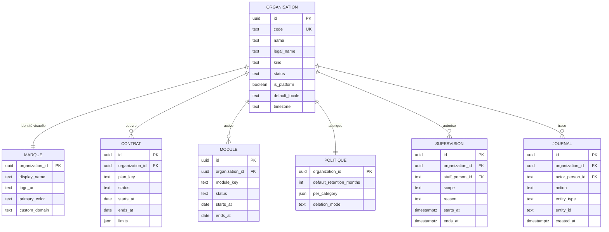
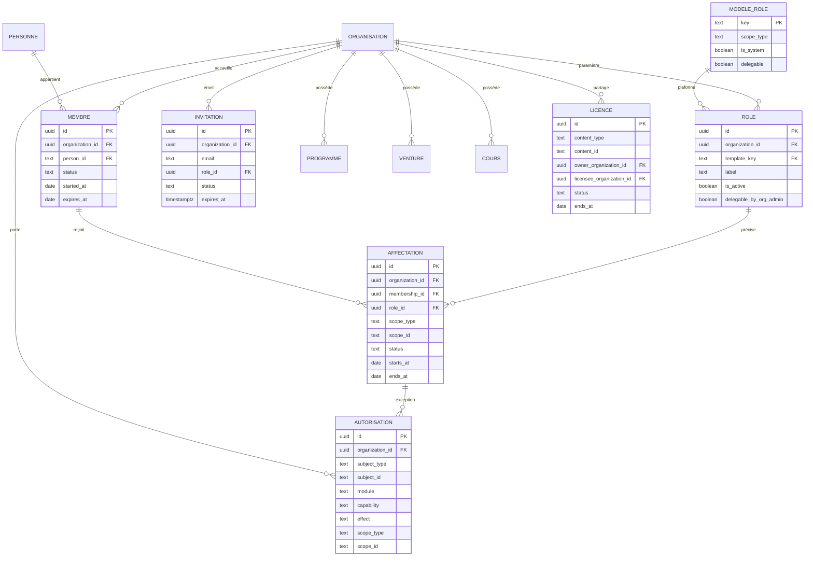

# White-label ImpactOS — Modèle de l’organisation cliente

> **Statut : proposition de conception. Aucune ligne de code applicatif n’est
> modifiée par ce document.** Il décrit la cible, les entités, les règles et les
> invariants. La mise en œuvre est décrite dans
> [`WHITE_LABEL_IMPLEMENTATION_SPEC.md`](./WHITE_LABEL_IMPLEMENTATION_SPEC.md).

> **Public :** produit, ingénierie, sécurité, support.
> **Documents liés :** [`ARCHITECTURE.md`](./ARCHITECTURE.md),
> [`AUTHZ_CURRENT_STATE.md`](./AUTHZ_CURRENT_STATE.md),
> [`LAYER_SPLIT.md`](./LAYER_SPLIT.md),
> [`MVC_REFACTOR.md`](./MVC_REFACTOR.md),
> [`LMS_ARCHITECTURE.md`](./LMS_ARCHITECTURE.md),
> [`PRODUCTION_TEST.md`](./PRODUCTION_TEST.md),
> [`WHITE_LABEL_DELIVERY_PLAN.md`](./WHITE_LABEL_DELIVERY_PLAN.md).

---

## 1. Objet

Le white-label permet à une organisation cliente d’utiliser les modules
**Programmes**, **LMS** et **Venture** sous sa propre identité, dans un espace
dont les utilisateurs, les données et les droits sont séparés de ceux de Future
Studio et des autres clients.

Ce document répond à trois questions :

1. Quelles sont les propriétés d’une organisation cliente ?
2. Comment une personne est-elle reconnue dans cet espace ?
3. Comment les droits sont-ils définis et calculés sans traverser les
   organisations ?

La contrainte centrale est de **ne pas réécrire le moteur de permissions
existant**. Le modèle ajoute une frontière au-dessus de l’existant :

```
Organisation → Appartenance → Affectation de rôle → Capacité → Périmètre → Fiche
```

Les trois premières couches sont nouvelles. Les deux dernières existent déjà
sous des formes différentes et restent la référence pour les écrans internes.

---

## 2. Vocabulaire et nommage

| Terme | Sens |
|---|---|
| **Organisation cliente** | La frontière d’un client : Université Horizon, une entreprise, une ONG, un incubateur. |
| **Organisation plateforme** | L’organisation interne de Future Studio. Elle est unique et non supprimable. |
| **Entreprise (CRM)** | Une entreprise suivie dans le CRM. Ce n’est **pas** une organisation cliente. |
| **Appartenance** | Le lien entre une personne globale et une organisation. |
| **Rôle d’organisation** (ou rôle d’espace) | Ce que la personne est dans l’organisation : administratrice, responsable de programme, coach, participante, investisseur, invitée. |
| **Affectation de rôle** | Le rôle **et** son périmètre : « coach d’AgriNova », « responsable de la cohorte 2027 ». |
| **Profil contextuel** | L’ancienne notion de fonction sur une fiche (participant, apprenant, fondateur, facilitateur…). Dans la cible, elle est absorbée par l’affectation de rôle. |
| **Capacité** | Une action précise : voir, créer, modifier, supprimer, exporter. |
| **Périmètre** | La fiche ou le sous-ensemble sur lequel la capacité s’applique. |
| **Module** | Programmes, LMS ou Venture, tel que souscrit au contrat. |
| **Licence de contenu** | Le droit d’utiliser un cours ou un modèle appartenant à une autre organisation. |
| **Supervision** | Un accès explicite, limité et journalisé de Future Studio au contenu d’un client. |

### Décision de nommage

Le mot « organisation » est déjà utilisé par le CRM pour les entreprises
suivies. Pour éviter la confusion :

- dans l’interface, **Organisation** désigne la frontière cliente ;
- dans l’interface CRM, **Entreprise** désigne l’entreprise suivie ;
- dans le code, la nouvelle table est `organizations` ;
- l’ancienne table reste `crm_organizations` et n’est **jamais** réutilisée
  comme frontière cliente.

---

## 3. Principes de conception

1. **Un seul produit, une seule base.** Pas de copie du code par client.
2. **Une frontière au-dessus du moteur existant.** On n’ajoute pas une quatrième
   vérification à l’intérieur du moteur ; on l’ajoute avant lui.
3. **Aucun cumul entre organisations.** Les droits sont calculés dans
   l’organisation active, jamais dans toutes les organisations de la personne.
4. **Le serveur est la seule autorité.** L’organisation active vient de la
   session authentifiée, jamais d’un identifiant fourni par l’écran.
5. **Le refus est la valeur par défaut.** Une erreur, une donnée manquante ou un
   périmètre vide refuse l’accès.
6. **La marque n’est pas une sécurité.** Le logo, les couleurs et le domaine
   n’accordent aucun droit.
7. **La migration est additive.** Les données existantes rejoignent
   l’organisation plateforme. Aucun rôle, profil ou droit existant n’est
   supprimé.
8. **Le pilote est borné.** Les écrans internes existants ne deviennent pas
   multi-organisations dans la première phase. Le portail client est une entrée
   séparée qui réutilise le moteur et les composants.
9. **La séparation fonctionne dans les deux sens.** Une requête interne ne doit
   pas voir les données clientes sans mandat, et une requête cliente ne doit
   jamais voir la plateforme ni une autre organisation.
10. **Les écritures existantes restent valides.** Une colonne d’organisation
    devenue obligatoire est remplie par un mécanisme de base pour les anciens
    chemins, avec l’organisation plateforme par défaut.
11. **L’historique est protégé par la base.** Les suppressions et modifications
    interdites sont refusées par des contraintes ou des déclencheurs, pas
    seulement par le service.

---

## 4. Vue d’ensemble

### 4.1 La frontière et le contrat



### 4.2 Les personnes et les droits



---

## 5. Les entités

Chaque enregistrement porte aussi son identifiant, ses dates de création et de
mise à jour, et l’auteur de la dernière modification. Ces champs ne sont pas
répétés dans chaque tableau.

### 5.1 Organisation

La fiche d’identité de la frontière. Elle ne contient **aucun droit**.

| Champ | Rôle | Règle |
|---|---|---|
| `id` | Identifiant | UUID généré |
| `code` | Identifiant lisible et stable | Unique, minuscules, `a-z`, `0-9` et tirets, 3 à 40 caractères, utilisé dans les liens et le support |
| `name` | Nom administratif | Obligatoire |
| `legal_name` | Nom légal | Contrat et facturation |
| `kind` | Type d’organisation | `company`, `university`, `incubator`, `ngo`, `public_body`, `other` |
| `status` | Cycle de vie | `draft`, `active`, `suspended`, `archived`, `closed` |
| `is_platform` | Organisation interne Future Studio | Une seule vraie, non supprimable |
| `parent_id` | Regroupement d’organisations | Optionnel |
| `default_locale` | Langue par défaut | `fr` ou `en` |
| `timezone` | Fuseau horaire | Affichage et planification |
| `data_region` | Région de données | Optionnel, selon le contrat |
| `suspended_reason` | Motif de suspension | Obligatoire si `status = 'suspended'` |
| `archived_at`, `closed_at` | Dates de sortie | Jamais de suppression physique avec des données |

**Les quatre noms :**

- `code` est l’identifiant technique et stable, utilisé dans les liens ;
- `name` est le nom administratif, utilisé par Future Studio ;
- `display_name` (dans la marque) est le nom vu par les utilisateurs ;
- `legal_name` est le nom contractuel et légal.

**Règles :**

- Une seule organisation porte `is_platform = TRUE`.
- `code` ne change plus après création.
- Les codes `select`, `invite`, `api`, `settings`, `admin` et `login` sont
  réservés et ne peuvent pas être attribués à une organisation.
- Un regroupement (`parent_id`) ne peut pas créer de cycle.
- Une organisation avec des données n’est jamais supprimée physiquement.
- Le nom affiché, le logo et les couleurs sont dans la marque, pas ici.

### 5.2 Marque

La présentation de l’organisation. Elle ne décide jamais d’un accès.

| Champ | Rôle |
|---|---|
| `organization_id` | Une marque par organisation |
| `display_name` | Nom visible par les utilisateurs |
| `logo_url`, `logo_dark_url`, `mark_url`, `favicon_url` | Identité visuelle |
| `primary_color`, `secondary_color`, `accent_color` | Palette |
| `email_from_name`, `email_from_address`, `reply_to` | Expéditeur des e-mails |
| `support_email`, `support_url` | Support affiché |
| `website_url`, `legal_url`, `privacy_url` | Liens légaux |
| `custom_domain`, `domain_verified_at` | Adresse personnalisée |
| `login_message` | Message d’accueil |

**Règle :** la marque est de l’affichage. Un logo différent n’est jamais une
frontière de données.

### 5.3 Contrat

Ce que l’organisation a souscrit, et jusqu’à quand.

| Champ | Rôle |
|---|---|
| `id` | Identifiant |
| `organization_id` | Organisation couverte |
| `plan_key` | Offre souscrite |
| `status` | `draft`, `active`, `suspended`, `ended` |
| `starts_at`, `ends_at` | Période contractuelle |
| `renewal_mode` | `manual` ou `auto` |
| `limits` | Plafonds : programmes, membres, ventures, stockage |
| `signed_at` | Date de signature |
| `notes` | Conditions particulières |

**Règles :**

- Une seule période active à la fois ; les périodes terminées restent en
  historique.
- La fin du contrat ne supprime aucune donnée : elle déclenche la politique de
  conservation.
- Les limites du contrat sont des **plafonds**, pas des droits utilisateur.
- Le statut du contrat et le statut de l’organisation sont distincts : une
  organisation peut être active pendant un renouvellement, ou suspendue pour un
  incident indépendamment du contrat.

### 5.4 Module

Les trois modules de l’offre, activés organisation par organisation.

| Champ | Rôle |
|---|---|
| `id` | Identifiant |
| `organization_id` | Organisation |
| `module_key` | `programs`, `lms`, `venture` |
| `status` | `enabled`, `disabled`, `trial`, `suspended` |
| `starts_at`, `ends_at` | Période d’activation |
| `limits` | Plafonds spécifiques au module |
| `enabled_by`, `enabled_at` | Qui a activé, quand |

**Règles :**

- Un module est activé par Future Studio, jamais par un utilisateur client.
- Désactiver un module ferme l’usage ; cela ne supprime ni les cours, ni les
  programmes, ni les ventures.
- Le module est une notion de contrat. Le droit d’une personne dans ce module
  est une autre question.

### 5.5 Appartenance

Le lien entre une personne globale et une organisation.

| Champ | Rôle |
|---|---|
| `id` | Identifiant |
| `organization_id` | Organisation |
| `person_id` | Personne globale |
| `status` | `invited`, `active`, `suspended`, `ended` |
| `started_at`, `expires_at` | Période d’appartenance |
| `ended_at`, `ended_reason` | Sortie |
| `invited_by`, `approved_by` | Qui a invité et qui a approuvé |

**Règles :**

- Une personne n’a **qu’une seule appartenance active** par organisation.
- Une personne peut avoir plusieurs appartenances, dans plusieurs organisations.
- La fin d’une appartenance retire les droits, jamais la personne ni son
  historique.
- Une personne n’est jamais dupliquée pour appartenir à deux organisations.

### 5.6 Modèle de rôle et rôle d’organisation

Deux niveaux, volontairement séparés :

- **Le modèle de rôle** est global. Il définit le plafond de ce qu’un rôle peut
  faire ; ses capacités sont stockées dans une table de liaison, pas dans un
  champ libre.
- **Le rôle d’organisation** est propre au client. Il peut changer de libellé et
  décider s’il est délégable, mais il ne peut jamais dépasser le plafond.

| Modèle de rôle | Portée naturelle | Socle | Interdits |
|---|---|---|---|
| Administrateur d’organisation | Organisation | Membres, invitations, marque, rôles délégués, rapports de son organisation | Catalogue global, console interne, supervision, autres organisations |
| Responsable de programme | Programme ou cohorte | Créer et organiser, affecter des coachs, suivre les activités | Programmes non affectés, autres organisations |
| Coach | Programme, cohorte ou venture | Consulter, commenter, accompagner, évaluer selon son mandat | Toutes les startups, les notes hors mandat, autres organisations |
| Participant | Programme ou cohorte | Voir son parcours, ses activités, ses remises | Autres participants, notes internes, autres organisations |
| Apprenant | Cours | Suivre ses cours, passer les évaluations, obtenir un certificat | Cours non inscrits, résultats des autres |
| Investisseur | Venture ou investissement | Voir les documents partagés et les indicateurs autorisés | Notes internes, résultats de formation, autres ventures |
| Responsable de contenu | Organisation ou cours | Créer et organiser les cours de son organisation | Cours d’une autre organisation sans licence |
| Invité | Objet précis | Voir un document ou un dossier partagé | Tout le reste |

La portée indiquée est la **portée naturelle** du modèle. Une affectation peut
utiliser une portée plus précise dans la même organisation : un coach affecté à
un programme, une cohorte ou un venture ; une participante affectée à une
cohorte ; un apprenant affecté à un cours ; un invité affecté à un document.

**Champs du rôle d’organisation :**

| Champ | Rôle |
|---|---|
| `id` | Identifiant |
| `organization_id` | Organisation |
| `template_key` | Modèle global utilisé |
| `label`, `description` | Libellé propre au client |
| `is_active` | Rôle disponible ou retiré |
| `delegable_by_org_admin` | L’administrateur client peut-il l’attribuer ? |

**Règles :**

- Un administrateur client peut renommer un rôle, pas lui donner plus de droits
  que son modèle.
- Il ne peut pas créer un rôle qui dépasse le plafond global.
- Un rôle d’organisation ne peut être délégable que si son modèle l’autorise.
- Un rôle retiré ne supprime pas les affectations existantes : il les rend
  inactives à la prochaine échéance.

### 5.7 Affectation de rôle

La phrase qui relie une personne, un rôle et un périmètre.

| Champ | Rôle |
|---|---|
| `id` | Identifiant |
| `organization_id` | Organisation, répétée pour la sécurité |
| `membership_id` | Appartenance concernée |
| `role_id` | Rôle attribué |
| `scope_type` | `organization`, `program`, `cohort`, `venture`, `course`, `investment`, `document` |
| `scope_id` | La fiche précise, ou vide pour l’organisation entière |
| `status` | `active`, `suspended`, `ended` |
| `starts_at`, `ends_at` | Période |
| `assigned_by` | Qui a attribué |
| `ended_reason` | Motif de fin |

**Règles :**

- Le périmètre doit appartenir à la **même organisation** que l’appartenance.
- Les dates de l’affectation restent dans les dates de l’appartenance.
- Une personne peut cumuler plusieurs affectations : participante d’une
  cohorte, apprenante d’un cours, fondatrice d’un venture.
- « Coach d’AgriNova » est une affectation de rôle Coach avec le venture
  AgriNova comme périmètre.
- « Responsable de la cohorte 2027 » est une affectation avec la cohorte 2027
  comme périmètre.

### 5.8 Autorisation et blocage

Les rôles donnent le socle. Cette entité ne sert qu’aux **exceptions** : une
autorisation nominative, une autorisation de groupe, ou un blocage.

| Champ | Rôle |
|---|---|
| `id` | Identifiant |
| `organization_id` | Organisation |
| `subject_type` | `role_assignment`, `membership`, `group` |
| `subject_id` | La personne ou le groupe concerné |
| `module`, `capability` | Le droit précis |
| `access_level` | Niveau pour une autorisation |
| `effect` | `allow` ou `deny` |
| `scope_type`, `scope_id` | Périmètre de l’exception (`organization`, `program`, `cohort`, `venture`, `course`, `investment`, `document`) |
| `starts_at`, `ends_at` | Période |
| `granted_by`, `reason` | Qui et pourquoi |
| `revoked_at`, `revoked_by` | Révocation explicite |

**Règles :**

- Un **refus** gagne toujours sur une autorisation.
- Une autorisation ne se supprime pas : elle se révoque par `revoked_at` et
  `revoked_by`, avec un événement de journal.
- Aucune autorisation ne traverse une organisation.
- Un administrateur client ne peut accorder que les droits **déléguables** de
  son propre rôle.
- Une autorisation ne peut pas contourner un module désactivé ni le plafond du
  modèle de rôle.
- Les autorisations de groupe supposent que le groupe appartient à la même
  organisation.

### 5.9 Invitation

L’invitation est la seule porte d’entrée d’une nouvelle personne dans une
organisation.

| Champ | Rôle |
|---|---|
| `id` | Identifiant |
| `organization_id` | Organisation |
| `email` | Destinataire, normalisé |
| `person_id` | Renseigné à l’acceptation |
| `role_id`, `scope_type`, `scope_id` | Ce qui sera attribué |
| `token_hash` | Jeton stocké sous forme d’empreinte |
| `status` | `pending`, `accepted`, `expired`, `revoked` |
| `expires_at` | Date limite |
| `invited_by`, `accepted_at`, `accepted_by` | Traçabilité |

**Règles :**

- Le domaine de l’e-mail peut **suggérer** une invitation, jamais l’accorder.
- Une invitation ne peut pas donner un rôle que l’invitant ne peut pas déléguer.
- À l’acceptation, le système vérifie que l’organisation est active et que le
  rôle existe encore.
- Une invitation acceptée crée une appartenance, jamais un rôle global.

### 5.10 Licence de contenu

Le cours partagé entre deux organisations.

| Champ | Rôle |
|---|---|
| `id` | Identifiant |
| `content_type` | `course`, `template`, `resource` |
| `content_id` | Le contenu concerné |
| `owner_organization_id` | Organisation propriétaire |
| `licensee_organization_id` | Organisation qui l’utilise |
| `status` | `active`, `revoked`, `expired` |
| `starts_at`, `ends_at` | Période |
| `terms` | Attribution, usages autorisés, droits de modification |
| `granted_by` | Qui a accordé |

**Règles :**

- Le contenu partagé ne partage **jamais** les résultats.
- L’inscription, la progression, les notes et le certificat restent dans
  l’organisation de l’apprenant.
- Révoquer une licence arrête les nouvelles inscriptions ; les résultats déjà
  produits restent selon le contrat.
- Si le client doit modifier le cours, on fait une copie ou une version dérivée,
  pas une licence d’écriture.

### 5.11 Supervision

L’accès de Future Studio au contenu d’un client.

| Champ | Rôle |
|---|---|
| `id` | Identifiant |
| `organization_id` | Organisation supervisée |
| `staff_person_id` | Membre du personnel Future Studio |
| `scope` | `read`, `export`, `administer` |
| `reason` | Motif, obligatoire |
| `starts_at`, `ends_at` | Mandat limité dans le temps |
| `status` | `active`, `ended` |
| `granted_by` | Qui a accordé |

**Règles :**

- Pas de mandat actif, pas d’accès au contenu client, y compris depuis la
  console interne.
- Chaque usage écrit une ligne de journal.
- La supervision est distincte de l’administration technique de la plateforme.
- Un salarié de Future Studio n’obtient pas l’accès parce qu’il est salarié : il
  l’obtient par un mandat.
- La supervision est un **prérequis d’activation** d’une organisation cliente :
  aucune organisation ne passe à `active` avant que ce contrôle soit en place et
  testé.

### 5.12 Journal et politique de conservation

**Journal.** Qui a fait quoi, dans quelle organisation, sur quelle fiche, quand.
Il est en ajout seul. L’administrateur client voit le journal de son
organisation ; Future Studio voit l’ensemble.

**Politique de conservation.** Durée par catégorie — programmes, formations,
ventures, fichiers, journal —, format d’export, mode de sortie : anonymiser ou
supprimer. Elle s’applique à la fin du contrat. Une obligation légale peut
suspendre la suppression.

### 5.13 Personas et reconnaissance

| Personne | Identité de plateforme | Rôle d’organisation | Affectations typiques | Ce qu’elle voit et fait | Ce qu’elle n’a jamais |
|---|---|---|---|---|---|
| **Administratrice client** | Membre | Administratrice d’organisation | Aucune, ou responsable de contenu | Gère les membres, la marque, les rôles délégués et le journal de son organisation | La console interne, les autres organisations, le catalogue global, la supervision |
| **Responsable de programme** | Membre | Responsable de programme | Programme ou cohorte | Crée et organise ses programmes et cohortes, affecte des coachs, suit les activités | Le portefeuille entier, les autres organisations |
| **Coach** | Membre | Coach | Programme, cohorte ou venture | Accompagne les personnes, cours et startups de son mandat | Toutes les startups, les notes hors mandat, les autres organisations |
| **Participante ou entrepreneure** | Membre | Participante | Cohorte, cours, venture | Voit son parcours, remet ses travaux, gère son dossier venture | Les autres dossiers, les notes internes, les résultats des autres |
| **Investisseur invité** | Membre | Invité ou investisseur | Venture ou document | Consulte les dossiers et documents explicitement partagés | Les notes du coach, les résultats de formation, les autres startups |
| **Future Studio** | Propriétaire ou personnel interne | Aucun rôle d’organisation | Supervision explicite | Administre la plateforme, fait du support, supervise avec un mandat | Le contenu client sans mandat, l’administration d’un espace sans trace |

Une même personne peut cumuler plusieurs lignes. Un salarié de Future Studio qui
intervient comme coach d’un client reçoit une appartenance et un rôle
d’organisation distincts ; son identité interne ne lui donne aucun droit
supplémentaire dans l’espace client. Dans la console interne, il ne voit par
défaut que l’organisation plateforme ; pour lire un contenu client, il lui faut
un mandat de supervision actif.

**Comment le système reconnaît une personne :**

1. La connexion désigne un compte et une seule personne.
2. Le système lit ses appartenances actives.
3. Si elle n’en a qu’une, elle devient l’organisation active ; si elle en a
   plusieurs, elle choisit.
4. Dans l’organisation active, le système lit le rôle d’organisation et les
   affectations valides.
5. Il calcule les droits pour cette organisation, jamais pour les autres.
6. Il vérifie que la fiche demandée appartient à cette organisation et au
   périmètre de la personne.
7. Il autorise ou refuse, et journalise.

**Ce qu’il n’utilise jamais pour reconnaître quelqu’un :** l’adresse de la page,
la sidebar, un choix stocké dans le navigateur, le domaine de l’e-mail, la marque
affichée, ou un identifiant d’organisation fourni par l’écran sans vérification.

---

## 6. Ce qui est global, ce qui est par organisation, ce qui est partagé

| Catégorie | Exemples | Porte l’organisation ? | Règle |
|---|---|---|---|
| **Identité globale** | Personne, compte, identité de plateforme | Non | Une personne, plusieurs organisations |
| **Configuration plateforme** | Catalogue des capacités, modèles de rôles, catalogue des modules | Non | Géré par Future Studio |
| **Données clientes** | Programmes, cohortes, ventures, inscriptions, remises, documents, rapports | Oui, obligatoire | Jamais de croisement |
| **Catalogue partagé** | Cours, modèles, ressources | Propriétaire | Licence explicite ; résultats chez l’apprenant |
| **Groupes** | Groupe interne, groupe client | Oui, sauf le groupe interne | Un groupe ne donne rien hors de son organisation |
| **Journal** | Événements de l’organisation | Oui | Visible par l’admin client, complet pour la plateforme |
| **Supervision** | Mandat Future Studio | Oui | Explicite, limité, journalisé |

### 6.1 Les fiches qui gagnent une organisation

- **Programmes** : programmes, cohortes, sessions, inscriptions, affectations de
  staff, KPI, documents et remises.
- **LMS** : cours possédés, sections et leçons (via le cours), inscriptions,
  progression, tentatives d’évaluation, certificats, exigences de programme.
- **Venture** : ventures, membres, tâches, livrables, documents, sessions,
  jalons, retours, rapports.
- **Transverse** : fichiers, exports, notifications, invitations, journal,
  groupes clients.

### 6.2 Les fiches qui n’en gagnent pas

- **La personne et son compte.** Une personne n’appartient pas à une
  organisation par nature ; c’est son **appartenance** qui le dit.
- **Le catalogue global des capacités.**
- **Les modèles de rôles globaux.**
- **Les entreprises du CRM.** Le CRM reste interne dans le pilote.
- **Le contenu d’un cours partagé** : le cours a un propriétaire, mais ses
  sections et leçons ne sont pas dupliquées par client.

### 6.3 Isolation dans les deux sens

| Requête | Organisation appliquée | Condition |
|---|---|---|
| Console interne, sans mandat | Organisation plateforme uniquement | Par défaut |
| Console interne, avec mandat de supervision | Organisation supervisée | Mandat actif, portée `read` ou `export`, journalisé |
| Portail client | Organisation active de la session | Appartenance active |
| Lien public | Organisation encodée dans le jeton | Objet unique, organisation active |
| Job de fond | Organisation passée explicitement | Aucun job « toutes organisations » sans mandat |

**Règles :**

- Une requête interne sans contexte d’organisation est limitée à l’organisation
  plateforme ; elle ne peut pas retourner une ligne cliente.
- Une requête interne qui vise une organisation cliente exige un mandat de
  supervision actif, même pour le propriétaire de la plateforme.
- Une requête cliente ne peut jamais atteindre l’organisation plateforme ni une
  autre organisation, même en forgeant un identifiant.
- Le contexte est posé au niveau du gestionnaire de requête et appliqué dans
  les modèles. Les déclencheurs de base vérifient l’écriture et les portées ; un
  verrou de lecture dans la base peut renforcer l’ensemble.
- Les tests d’isolation sont bidirectionnels : interne → client et client →
  interne.

---

## 7. Comment un droit est calculé

Pour chaque action, dans l’ordre :

0. **Poser le contexte d’organisation de la requête** : organisation plateforme
   par défaut pour l’interne, organisation active pour le portail, organisation
   supervisée pour un mandat.
1. **Identifier la personne** à partir de sa connexion.
2. **Trouver son appartenance active** dans l’organisation active.
3. **Vérifier l’état de l’organisation** : active, non suspendue, non archivée.
4. **Vérifier le module** : le contrat inclut-il ce module pour cette
   organisation ?
5. **Rassembler les affectations de rôle valides** à cet instant, dans cette
   organisation.
6. **Partir du socle** de chaque modèle de rôle.
7. **Ajouter les autorisations** nominatives ou de groupe, dans cette
   organisation.
8. **Retirer les refus**, qui gagnent toujours.
9. **Appliquer le plafond du modèle de rôle.**
10. **Vérifier le périmètre de la fiche** : programme affecté, venture dont elle
    est membre, cours où elle est inscrite, document explicitement partagé.
11. **Vérifier que la fiche appartient à l’organisation active.**
12. **Autoriser ou refuser, et tracer.**

La règle centrale : **rien ne s’additionne entre organisations.** Les rôles, les
autorisations et les refus sont lus dans l’organisation active, jamais dans
toutes les organisations de la personne.

---

## 8. Cycle de vie d’une organisation

| Statut | Accès client | Invitations | Écritures | Données |
|---|---|---|---|---|
| `draft` | Non | Non | Future Studio seulement | Configurables |
| `active` | Oui | Oui | Oui, selon les droits | Normales |
| `suspended` | Non : accès refusé | Non | Non | Conservées |
| `archived` | Non | Non | Non | Lecture Future Studio, conservation |
| `closed` | Non | Non | Non | Export/suppression selon la politique |

**Règles de transition :**

- `draft → active` : contrat signé et modules activés.
- `active → suspended` : incident, impayé ou décision contractuelle, avec motif.
- `suspended → active` : régularisation.
- `active → archived` : fin de contrat.
- `archived → closed` : export et suppression ou anonymisation.
- Une organisation ne passe jamais directement de `closed` à `active` ; une
  nouvelle organisation est créée si le client revient.

**Prérequis d’activation :** une organisation ne peut passer à `active` que si
l’isolation bidirectionnelle, la supervision et les garanties d’historique sont
en place et testées. Sinon, elle reste en `draft`.

---

## 9. Invariants

| Invariant | Pourquoi |
|---|---|
| Une seule organisation plateforme | Évite un second propriétaire |
| Toute fiche cliente porte une organisation | Empêche les fiches orphelines |
| Aucune liaison entre deux organisations, sauf une licence | Empêche les fuites |
| Le périmètre d’une affectation appartient à la même organisation | Empêche un coach d’être affecté ailleurs |
| Une autorisation porte l’organisation | Empêche un droit de voyager |
| Un refus gagne sur une autorisation | Comportement prévisible |
| Un administrateur client ne dépasse pas le plafond de son rôle | Empêche l’escalade |
| La fin d’appartenance conserve l’historique | Continuité et audit |
| Une organisation suspendue refuse tout accès client, y compris lecture, invitation et écriture | Arrêt propre, données conservées |
| La supervision exige un mandat actif | Pas d’accès implicite |
| Le journal est en ajout seul | Preuve |
| Une requête interne sans contexte est limitée à l’organisation plateforme | Empêche la fuite interne → client |
| Aucune ligne cliente n’est lisible sans mandat de supervision | Le support ne contourne pas la frontière |
| Une écriture existante sans organisation reçoit l’organisation plateforme | Aucune création interne cassée |
| Les tables d’historique refusent les suppressions et modifications interdites | L’historique ne dépend pas du service |
| Aucune organisation cliente n’est activée avant les contrôles | Pas de données réelles sans isolation |

---

## 10. Exemple concret : Université Horizon

| Élément | Valeur |
|---|---|
| Organisation | `horizon`, Université Horizon, active, non plateforme |
| Marque | Logo Horizon, couleurs, `bonjour@horizon.example`, domaine `app.horizon.example` |
| Contrat | Offre accompagnement, du 01/09/2026 au 31/08/2027, plafonds définis |
| Modules | Programmes activé, LMS activé, Venture activé |
| Membre | Amina, active |
| Affectation 1 | Participante, cohorte 2027 |
| Affectation 2 | Apprenante, cours « Pitch » |
| Affectation 3 | Fondatrice, venture AgriNova |
| Membre coach | Active |
| Affectation coach | Coach, venture AgriNova |
| Licence | Cours « Pitch », propriétaire Future Studio, licencié Horizon |
| Supervision | Support Future Studio, lecture, 2 heures, ticket 123 |

Ce que cela produit :

- Amina voit son programme, son cours et son venture.
- Sa coach voit AgriNova parce qu’elle y est affectée, pas toutes les startups.
- L’administratrice Horizon voit l’appartenance d’Amina, pas les autres
  organisations d’Amina.
- L’investisseur voit le deck partagé, pas les notes de la coach ni les résultats
  de formation.
- En 2028, Amina reçoit une nouvelle affectation dans la nouvelle cohorte. Les
  résultats de 2027 restent attachés à 2027.

---

## 11. Correspondance avec le modèle actuel

| Élément actuel | Devient | Ce qui ne change pas |
|---|---|---|
| Personne et compte | Personne globale | Identifiant, e-mail, statut |
| Identité de plateforme | Identité de plateforme | Les trois familles restent |
| Profil contextuel | Affectation de rôle avec périmètre | Les fonctions restent les mêmes |
| Autorisation personnelle | Autorisation d’organisation | Le droit reste le même, avec une organisation |
| Autorisation de groupe | Autorisation d’organisation | Le groupe est rattaché à une organisation |
| Blocage | Autorisation de type `deny` | Un refus gagne toujours |
| Programme, venture, cours | Fiche cliente avec organisation | Les données et relations existantes |
| Inscription, progression, certificat | Fiche cliente avec organisation | Les résultats restent attachés à l’inscription |
| Groupe interne | Groupe de l’organisation plateforme | Le groupe FUTURE STUDIO reste protégé |
| Session | Session + organisation active | La session reste une session |

**Point d’attention :** les profils réservés aujourd’hui au personnel interne
(responsable de programme, responsable de venture, responsable de cours) ne
doivent pas devenir accessibles en transformant un client en « personnel
interne ». La cible les traite comme des **rôles d’espace**, avec un plafond
défini par Future Studio.

---

## 12. Décisions produit et points restant à valider

1. **Nommage** : « Organisation » pour la frontière cliente, « Entreprise » pour
   le CRM. Validation produit.
2. **Contenu partagé** : licence ou copie. Recommandation : licence.
3. **Organisation suspendue — décision confirmée le 22 octobre 2026** : refus de
   tout accès client, y compris en lecture. Aucune période de grâce en lecture
   seule ; les données restent conservées. Cette décision ne définit pas à elle
   seule les droits de supervision de Future Studio.
4. **Rôles personnalisés** : en version 1, renommage et délégation seulement,
   pas de nouveaux droits au-delà du plafond.
5. **Investisseur** : appartenance de type invité avec partage explicite, ou
   partage direct sans appartenance. Recommandation : appartenance invitée +
   partage explicite, pour que la révocation et l’audit soient propres.
6. **Suppression** : anonymisation ou suppression à la fin du contrat. À fixer
   par contrat et par catégorie de données.
7. **Domaine personnalisé** : sous-domaine fourni par Future Studio ou domaine
   du client. Ce n’est jamais une frontière de sécurité.
8. **Éligibilité du portail** : le portail applique le plafond du modèle de rôle
   d’organisation, distinct des lignes d’éligibilité internes. Les deux régimes
   ne se mélangent pas.
9. **Isolation interne** : verrou dans la base dès la Phase 1 (recommandé) ou
   filtre applicatif exhaustif. Si le filtre applicatif est choisi, aucune
   donnée cliente ne passe en production avant couverture complète.
10. **Supervision** : implémentée avant l’activation de la première organisation
    cliente, pas en fin de programme.
11. **Écritures existantes** : déclencheur ou valeur par défaut vers
    l’organisation plateforme, avec validation de l’organisation de session.
12. **Historique** : déclencheurs de non-suppression et d’immuabilité, journal
    en ajout seul protégé par la base.

---

## 13. Critères d’acceptation du modèle

Le modèle est considéré comme validé lorsque :

- chaque entité a une clé, des contraintes et une règle de suppression ;
- chaque droit peut être expliqué par une appartenance, une affectation et une
  fiche ;
- aucun droit ne peut être accordé sans organisation ;
- un administrateur client ne peut pas dépasser son plafond ;
- un contenu partagé ne transporte jamais les résultats d’un apprenant ;
- la fin d’une appartenance ne supprime ni la personne ni l’historique ;
- la supervision est explicite, limitée et journalisée ;
- le scénario Horizon est reproductible avec des données fictives ;
- les invariants sont couverts par des tests automatisés ;
- une requête interne ne peut pas lire une ligne cliente sans mandat ;
- les anciens chemins de création continuent de fonctionner et rattachent
  correctement l’organisation plateforme ;
- les suppressions et modifications interdites échouent au niveau de la base ;
- la supervision est testée avant l’activation d’une organisation cliente.

---

## 14. Journal des décisions

| Date | Décision | Statut |
|---|---|---|
| 2026-10-22 | Création du modèle conceptuel | Proposition |
| 2026-10-22 | Organisation suspendue : refus de tout accès client, sans lecture seule ni période de grâce ; données conservées | Confirmé par Christelle dans la conversation |
| 2026-10-22 | Séparation Organisation / Entreprise CRM | À valider |
| 2026-10-22 | Licence de contenu plutôt que copie | À valider |
| 2026-10-22 | Portail client séparé de la console interne | À valider |
| 2026-10-22 | Isolation bidirectionnelle, y compris pour l’interne | À valider |
| 2026-10-22 | Supervision avant activation de la première organisation | À valider |
| 2026-10-22 | Écritures existantes sécurisées par trigger/default plateforme | À valider |
| 2026-10-22 | Historique protégé par des déclencheurs et des privilèges de base | À valider |
